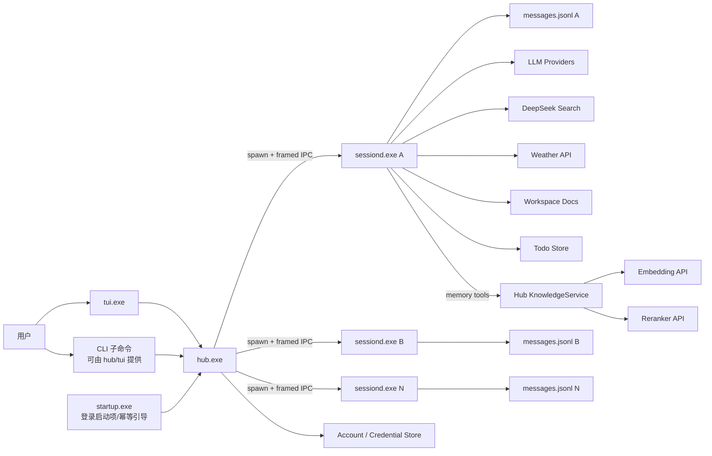
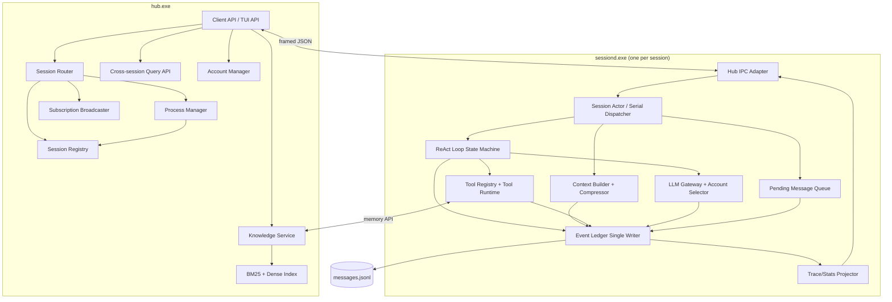
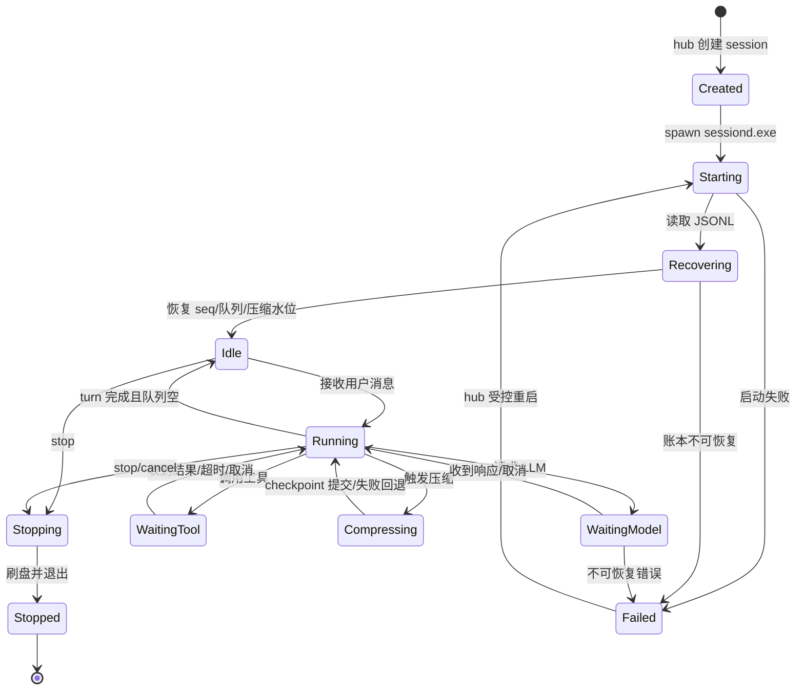
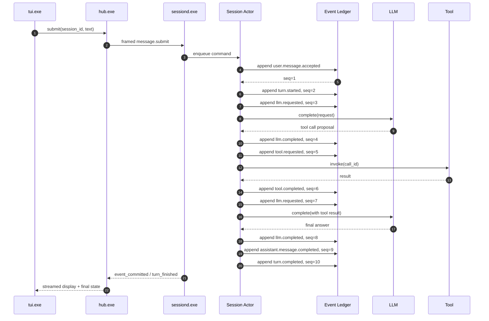
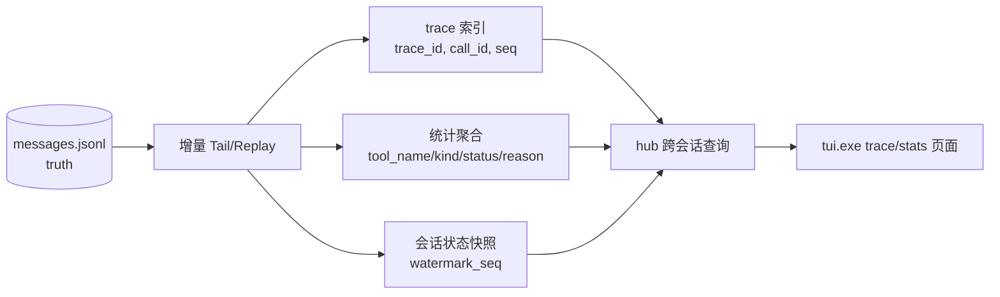
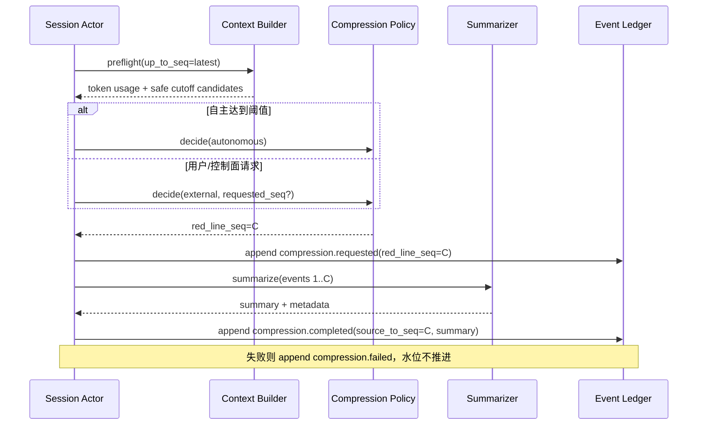

# 整体架构与运行时设计

## 1. 架构原则

1. **会话隔离是进程隔离**：每个活跃 Session 对应一个独立 `sessiond.exe`，不用 goroutine 代替进程边界。
2. **顺序只有一个所有者**：sessiond 内的 Actor 是会话命令和事件的唯一串行入口，只有事件写者发放 `seq`。
3. **Hub 不写会话真相**：hub 管理进程、路由和独立的共享知识库，但不修改会话事件账本，也不决定会话内先后。
4. **事件先于投影**：先提交 `messages.jsonl`，再通知订阅者、更新统计缓存或生成快照。
5. **压缩不重写历史**：压缩生成新的 checkpoint 事件，通过 `red_line_seq` 指向源事件边界。
6. **前端可替换**：先提供 TUI，同一 Hub API 后续可供更丰富的客户端使用。
7. **显式依赖**：所有组件由 bootstrap/factory 注入，不使用全局单例。
8. **契约集中、领域内藏**：跨进程稳定类型放公共 `pkg/contracts`；领域实体和存储实现留在各自模块内部。

## 2. 系统上下文



`hub.exe` 是控制面，`sessiond.exe` 是会话数据面。TUI 与 CLI 都只依赖 Hub API；sessiond 不监听公共端口。

## 3. 可执行文件边界

### 3.1 `hub.exe`

负责：

- 维护 Hub 单实例锁和本地控制面。
- 管理 `session_id -> pid/generation/state/transport` 进程表。
- 创建会话目录、分配 session 身份并启动对应 `sessiond.exe`。
- 把 CLI/TUI 的发送、取消、压缩、查询等命令路由到正确 sessiond。
- 把 sessiond 输出归一化为订阅事件并广播给 attach 的客户端。
- 处理 sessiond 异常退出、重启、孤儿回收和状态对账。
- 提供跨会话的索引与统计查询入口。
- 托管跨会话 KnowledgeService（memory record/chunk、BM25 索引、向量索引、混合召回）。
- 托管 AccountStore/CredentialRef 路由，并为 chat/embedding/rerank/search 选择能力绑定。

不负责：

- 不向 `messages.jsonl` 追加事件。
- 不决定 ReAct 步数、工具选择或上下文压缩。
- 不在 hub 内创建“每会话 Actor goroutine”作为业务运行时。

### 3.2 `sessiond.exe`

每个活跃 Session 恰好一个 sessiond。负责：

- 启动时加载并校验该会话事件流，恢复最后合法 `seq`。
- 由 Actor 串行处理消息、turn、LLM 回调、工具回调、压缩和停止命令。
- 管理待发送消息队列和中断策略。
- 运行 ReAct Loop 状态机。
- 执行上下文构建和自主/非自主压缩。
- 作为该会话 `messages.jsonl` 的唯一追加写者和 `seq` 发放者。
- 执行工具调用并发起 LLM 请求。
- 记录工具请求模式、结构化异常和 queue/validation/execute/total 耗时。
- memory 工具通过 Hub KnowledgeService 执行召回；Session 事件仍由 sessiond 写入。
- 生成 trace/统计投影或向 hub 暴露可增量消费的事件。

不负责：

- 不管理其他 Session。
- 不直接向 TUI/CLI 暴露网络端口。
- 不直接删除或重写事件历史。

### 3.3 `startup.exe`

负责：

- 检查 Hub 单实例状态；不存在则以后台方式幂等启动 `hub.exe`。
- 安装、检查、移除当前用户级登录启动项。
- 启动失败时写入本地诊断日志并返回稳定退出码。
- 可选的启动超时、重试和版本一致性检查。

不负责：

- 不启动 sessiond。
- 不恢复会话内容。
- 不代替 TUI 或 CLI 执行业务命令。

### 3.4 `tui.exe`

负责：

- 连接 Hub API，展示会话列表、当前流式回复、工具调用状态和错误。
- 发送用户消息、取消当前 turn、触发手动压缩。
- 查看 trace、工具统计、压缩 checkpoint 和 LLM 账户信息。
- 在断线后重连并从事件 `seq` 恢复视图。

不负责：

- 不直接访问 JSONL。
- 不直接启动/寻址 sessiond。
- 不在客户端维护唯一会话状态；客户端状态只是 Hub 读模型。

## 4. 进程内组件



`Actor` 是 sessiond 内部的确定性串行调度器。Go 的 goroutine 可承担 socket/stdio 读写、HTTP 请求和信号监听，但不用于创建/隔离 Session。跨进程边界始终是 hub 与 sessiond。

## 5. IPC 与协议

### 5.1 Hub ↔ TUI/CLI

- 首版仅绑定 `127.0.0.1`，端口写入用户配置目录的 Hub 状态文件。
- 启动时生成随机控制 token，客户端必须携带；token 不写入会话事件。
- 帧格式：`uint32 length + JSON payload`，设置最大帧大小。
- 请求包含 `request_id`，响应和事件订阅通过 `request_id`/`subscription_id` 关联。
- 支持 HTTP/1.1 keep-alive 或同进程内 loopback framed socket；协议层与业务 handler 解耦。

当前实现把恢复语义收敛到三个 additive v1 方法：

- `session.snapshot`：返回最新 tail、process state、watermark 和
  `has_more_before`；刷新只替换 tail，不清掉已翻历史。
- `session.history`：按 `before_seq` 返回紧邻的升序历史页，用于 tail+older
  接缝合并。
- `session.watch`：以最后应用 `seq` 作为 `after_seq`，最多等待 30 秒；
  返回 `cursor/has_more/timed_out/resync_required`。

调用方只有在事件被应用后才推进 cursor。`resync_required=true` 时不得从最终
消息猜测缺失的工具链，必须重新读取 snapshot。该语义兼容未来升级为 SSE、
WebSocket 或命名管道推送，领域事件和缓存规则不变。

### 5.2 Hub ↔ sessiond

- hub 使用 `os/exec` 启动 `sessiond.exe`，但业务通信不绑定父子 stdin/stdout。
- 每个 sessiond 暴露一个进程独占的本地端点：Windows 使用当前用户 ACL 限制的 named pipe，Linux/macOS 使用数据目录下权限受限的 Unix domain socket。
- 端点名称、pid、generation、协议版本和 token 的引用写入受保护的 `sessiond.json`；token 本身短期有效且不进入会话事件。
- hub 启动或恢复时扫描 `sessiond.json`，校验 pid/generation/session lock/协议版本后 attach。hub 重启不会强制结束仍健康的 sessiond。
- sessiond 不监听公共 TCP 端口，降低权限和攻击面。
- hub 只向 sessiond 发送控制命令和用户消息；sessiond 向 hub 发送归一化通知，如 `event_committed`、`assistant_delta`、`state_changed`、`turn_finished`、`fatal_error`。
- 连接中断时 sessiond 继续完成当前已提交的安全操作并写入 JSONL；事件提交不依赖 hub 在线。重连后 hub 从最后确认的 `seq` 补齐视图。
- `assistant_delta` 是流式传输帧，不是领域事件；最终消息/LLM 响应事件进入 JSONL 后才成为权威事实。

## 6. 会话生命周期



`hub` 的会话状态是 `sessiond` 状态的缓存。每次重启后，以 sessiond 重放结果和健康握手为准，不能只信任 hub 内存。

会话连接状态与业务状态分离：连接状态可以是 `Attached`/`Detached`，而 turn 仍可能在 `WaitingModel`、`WaitingTool` 或 `Compressing`。hub 断开不是 sessiond 的业务终止信号。

## 7. 一次对话事件流



注意：实际 LLM/tool 请求可以异步完成，但所有回调都作为命令回到 Actor；不得从网络回调直接写文件或修改会话状态。

## 8. Trace 与统计读模型



- 索引文件都携带 `watermark_seq`。
- 查询会报告投影水位；不足时先追赶或从源重建。
- 工具统计至少记录调用开始、完成和失败分类；失败原因使用稳定枚举。
- trace 的主链由 `trace_id`、`causation_seq`、`call_id` 恢复，不依赖 wall clock 或日志文本。

## 9. 压缩运行时



`red_line_seq` 是会话事件 seq，不是 token 数、文件偏移或时间戳。详细算法见 [事件、seq 与上下文压缩规范](05-events-and-compression.md)。

## 10. 存储布局

建议布局：

```text
<data-root>/
  hub/
    state.json              # hub 非权威运行状态/端口/版本
    startup.json            # 启动项状态
    logs/
  sessions/
    <session_id>/
      messages.jsonl        # 唯一会话真相源
      session.lock          # 单写者/进程租约
      sessiond.json         # pid/generation/IPC 端点/协议版本/token 引用
      projections/
        trace.jsonl         # 派生，可重建
        stats.json          # 派生，可重建
        snapshot.json       # 派生，可重建
      workspace/            # 工具允许访问的文档根目录
  memory/
    records.jsonl           # 跨会话 memory 真相数据
    chunks.jsonl            # 派生 chunk，可重建
    lexical/                # BM25 snapshot + manifest
    vectors/                # 按 embedding fingerprint 分区的向量
  accounts/
    accounts.jsonl          # 账户快照，每行一个账户，不含明文密钥
    accounts-audit.jsonl    # 账户管理审计，可追加
    smoke-reports/          # 脱敏后的真实 API smoke 报告
  logs/
```

凭据只能通过 `CredentialStore` 引用；默认从环境变量或操作系统凭据适配器读取。

## 11. 故障与恢复

| 故障 | 处理 |
|---|---|
| TUI 断开 | Hub 保留订阅路由；TUI 重连后从最后确认的 `seq` 恢复，必要时重放 |
| Hub 崩溃 | 已启动的 sessiond 不强制退出，继续持久化当前会话；新 hub 扫描 `sessiond.json` 后校验并重新 attach，旧 hub 的临时订阅失效 |
| sessiond 崩溃 | 只影响该会话；Hub 标记失败，按策略重启并重放 JSONL |
| JSONL 末尾半行 | 启动时校验；忽略/隔离最后不完整行，从最后合法 seq+1 继续 |
| 重复启动同一会话 | 会话锁 + generation 校验阻止双写；新进程只接管旧进程确认死亡后的租约 |
| 压缩摘要失败 | 保留原上下文，记录失败事件，不推进有效水位 |
| 工具超时 | 记录 `tool.completed(status=failed,reason=timeout)`，Loop 可将结构化错误反馈给模型 |
| 工具额度不足 | 记录 `tool.failed(reason_code=quota_exhausted)`，返回 retryable=false 和 reset_at，不自动切换未授权账户 |
| embedding/reranker 失败 | strict 返回稳定错误；显式允许 degraded 时，检索结果标记 `partial_result` 并列出实际通道 |
| Knowledge 索引半更新 | copy-on-write snapshot + 原子替换；查询只读取完整 index version |
| Hub/sessiond 协议不兼容 | 版本握手失败，拒绝启动并给出明确诊断 |

## 12. 关键不变量

- `sessiond.exe` 是事件账本唯一写者。
- hub 短时离线不影响 sessiond 向真相源提交事件；恢复后按 seq 重新同步视图。
- Actor 是会话可变状态的唯一入口。
- `seq` 只由单写者在提交前分配。
- 所有会话领域事件都写入真相源；流式分片不属于领域事件。
- Hub 不写事件；TUI 不改状态；工具不写事件。
- 模型工具调用和 Slash 直调共享 Registry/Tool Runtime，但 `invocation_mode` 必须不同。
- 工具成功/失败事件必须包含单调时钟计算的耗时；provider 自由文本不能成为统计主键。
- memory 的 BM25/dense/rerank 排名必须绑定 index/model 版本，不能混用不同 embedding fingerprint。
- 投影落后不会改变真相源内容，删除投影不会丢事实。
- 压缩不会删除源事件，不会切断未完成调用。

## 13. 公共契约包与 Account 角色

公共包的目录形态：

```text
pkg/contracts/
  account/v1/
  credential/v1/
  session/v1/
  tool/v1/
  knowledge/v1/
```

约束：

- `pkg/contracts` 不 import `internal/*`。
- 版本化 DTO 使用显式 JSON tag；领域对象通过 mapper 转为可公开的 View。
- 每个 contract 只暴露调用方需要的字段；secret、文件路径、存储句柄和内部统计结构不能进入公共 DTO。

Account 角色：

| 模块 | 权限 | 可调用操作 |
|---|---|---|
| Hub AccountAdmin | 读 + 写 | list/get/create/update/set-default/enable/disable/archive/validate/smoke |
| Hub AccountReader | 读 | get/resolve-for-invocation |
| Sessiond AccountReader | 读 | get/resolve-for-invocation/credential lease |
| TUI/CLI | 经 Hub 授权 | 管理操作 + 只读视图 |
| Tool/Provider adapter | 消费已解析 binding | 不直接访问 AccountStore |

Hub 提供两个逻辑 surface：

- 管理面：接受 `account:write` 和管理员 token，写入带 revision 与审计。
- Sessiond 只读面：只接受 `account:read`，方法 allowlist 不包含任何写方法。

完整契约、操作矩阵与每个模块的用例图见 [Account 公共契约与模块角色用例](11-account-contract-and-role-usecases.md)。
