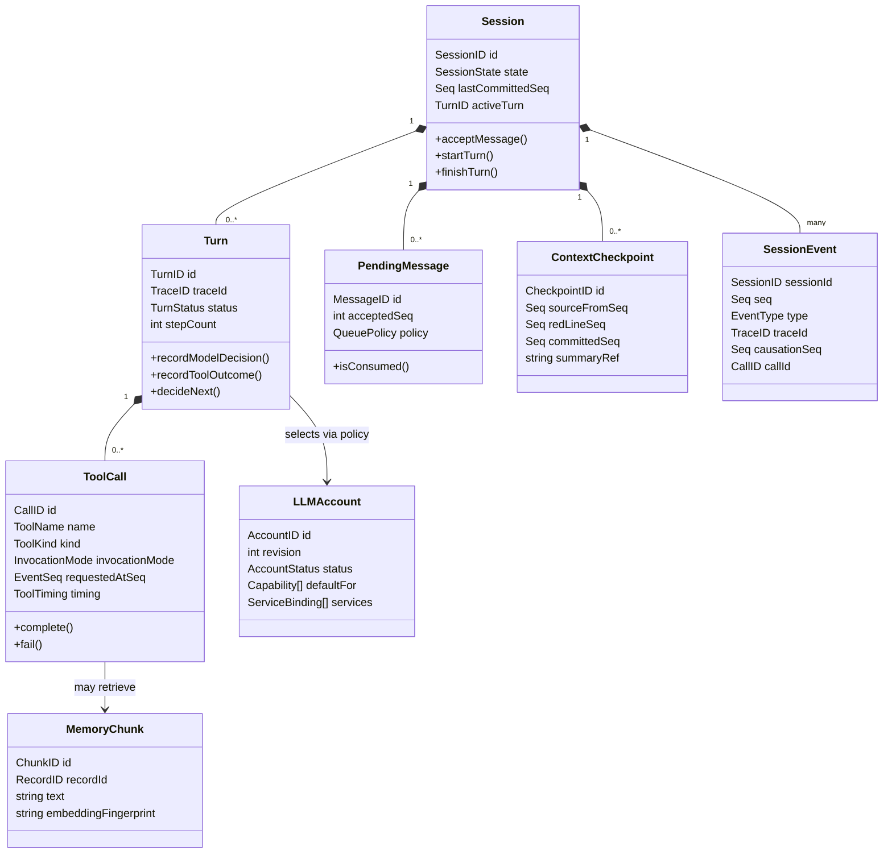
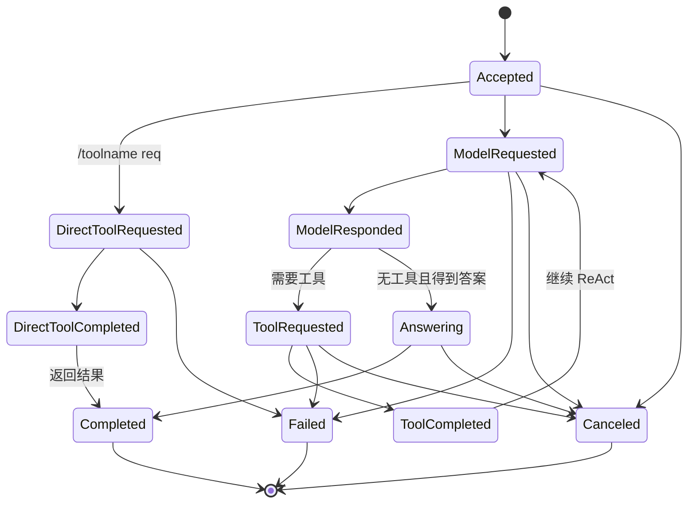

# DDD 领域模型

## 1. 限界上下文

| 限界上下文 | 核心职责 | 拥有的概念 | 主要依赖 |
|---|---|---|---|
| Conversation | 会话、turn、ReAct 状态、待发送消息策略 | Session、Turn、Step、Message、LoopState | Event Ledger ports、Tool ports、LLM ports、Context ports |
| Event Ledger | 事件信封、seq 发放、追加写入、重放 | Event、Seq、EventRef、SessionStream | 文件/平台时间源适配器 |
| Context Management | 上下文预算、压缩策略、安全红线、摘要构建 | ContextView、Checkpoint、RedLine、CompressionPolicy | Event Ledger read port、Summarizer |
| Tooling | 工具元数据、参数校验、直接/模型调用、生命周期、异常与耗时 | ToolSpec、ToolCall、InvocationMode、ToolResult、ToolFailure、ToolTiming | Event recorder port、具体工具适配器 |
| Account & Routing | 账户生命周期、能力绑定、凭据引用、默认路由和冒烟 | Account、ServiceBinding、Capability、CredentialRef、SmokeTest | Credential/HTTP adapters |
| LLM Access | provider 协议调用、token usage、错误归一化 | ModelRequest、Completion、EmbeddingBatch、RerankResult | Account selection port、网络适配器 |
| Knowledge Retrieval | memory record/chunk、BM25、向量、融合、rerank | MemoryRecord、MemoryChunk、LexicalIndex、HybridHit、RetrievalTrace | Embedding/Rerank ports、Hub IPC |
| Session Runtime | hub/sessiond 进程、IPC、生命周期、路由 | Hub、SessionProcess、Generation、Transport | Conversation control port、platform process API |
| Observability | trace 与统计数据读取 | TraceView、ToolStat、FailureBreakdown | Event Ledger read port |
| Operator Interaction | CLI/TUI 命令与显示模型 | SessionListItem、EventView、Command | Hub query/control ports |

边界规则：

- Conversation 不依赖文件系统或 HTTP SDK；通过端口调用。
- Tooling 的具体工具可以依赖外部系统，但必须通过统一 ToolHandler 接口被调用。
- Account & Routing 不解析 Session，只按 capability 提供安全账户选择。
- Account 跨进程 DTO 位于公共 `pkg/contracts/account/v1`；Hub 注入读/写角色，Sessiond 只注入 Reader。
- Account 写操作只能经 Hub AccountAdmin；Sessiond 的只读接口不能通过类型断言获得写能力。
- Knowledge Retrieval 不拥有 tool events；memory tool 的 Session 事件由 Tooling/Actor 记录。
- Context Management 只读事件，不直接写 Event Ledger；压缩事件草稿由 Conversation/Actor 提交。
- Observability 只读真相源，不能改变 Runtime 状态。
- Session Runtime 不做对话决策。

## 2. 核心领域概念



`SessionEvent` 既表达领域事实，也承担会话内集成事件。首版不引入消息总线；同一 sessiond 内通过 Actor 和事件账本驱动。

## 3. 聚合与一致性

### 3.1 Session 聚合

根对象：`Session`。

聚合内规则：

- `lastCommittedSeq` 只能递增 1。
- 一个 Session 同时最多一个活动 Turn（首版）。
- Turn 完成后才能消费下一条排队消息；`cancel-and-queue` 先完成取消事件，再进入新 turn。
- 压缩 checkpoint 只能指向提交时已存在的安全 `red_line_seq`。
- 会话停止前，事件写者必须 flush；未提交草稿不改变聚合版本。

Session 聚合状态主要由事件重放得到。`snapshot.json` 只是加速投影，不是权威源。

### 3.2 Turn 生命周期



每次状态迁移都是会话领域事件。重放时以事件为准，不使用 UI 展示状态推断。

### 3.3 事件账本一致性

- Event Ledger 是会话内的强顺序边界，不是分布式事务边界。
- 外部工具是否已经产生副作用，通过 `tool.requested` + `tool.completed|failed` 与幂等键表达。
- 工具已经执行但结果事件写入失败时，重启后不能盲目重复有副作用的调用；必须使用 `idempotency_key` 查询/重试。
- 压缩摘要和源事件之间通过 `red_line_seq + source_digest` 关联，提交摘要前校验摘要来源未变。

## 4. 会话事件目录

事件类型使用稳定字符串，payload 采用版本化 JSON。

| 事件类型 | 何时产生 | 关键字段 | 是否改变有效上下文 |
|---|---|---|---|
| `session.started` | sessiond 完成恢复并进入可服务状态 | `schema_version`、`recovered_seq` | 否 |
| `user.message.accepted` | Actor 接收一条用户消息 | `message_id`、`queue_policy`、`text` | 是 |
| `user.message.consumed` | 某消息被纳入 turn | `message_id`、`turn_id` | 是（消费关系） |
| `user.tool_command.accepted` | Actor 接收 `/toolname req` 直调 | `request_id`、`tool_name`、`raw_request`/安全摘要、`idempotency_key` | 是 |
| `turn.started` | 创建新 turn | `turn_id`、`trace_id`、`kind=chat / direct_tool` | 是 |
| `llm.requested` | 发出模型请求前 | `account_id`、`model`、`purpose`、`input_refs` | 是 |
| `llm.completed` | 收到归一化模型响应 | `usage`、`finish_reason`、`response` | 是 |
| `llm.failed` | 模型调用失败 | `reason_code`、`retryable`、`provider_request_id` | 是 |
| `tool.requested` | 调用工具前 | `call_id`、`tool_name`、`tool_kind`、`invocation_mode=model / direct`、`args_digest` | 是 |
| `tool.completed` | 工具成功并归一化结果 | `call_id`、`result`、`timing`、可选 retrieval metadata | 是 |
| `tool.failed` | 工具失败/超时/取消/额度不足 | `call_id`、`error`、`timing`、`retryable` | 是 |
| `assistant.message.completed` | turn 最终回答形成 | `message_id`、`text`、`turn_id` | 是 |
| `turn.completed` | turn 结束 | `turn_id`、`status`、`step_count` | 是 |
| `compression.requested` | 接受压缩请求 | `red_line_seq`、`trigger=autonomous / external`、`policy_version` | 否 |
| `compression.completed` | 摘要提交成功 | `source_from_seq`、`source_to_seq`、`summary`、`source_digest` | 改变 checkpoint |
| `compression.failed` | 摘要失败 | `red_line_seq`、`reason_code` | 否 |
| `session.stopping` | 开始优雅退出 | `reason` | 否 |
| `session.stopped` | 已刷盘停止 | `last_committed_seq` | 否 |

事件目录是契约，新增事件必须评审兼容性。事件 payload 变更使用 `schema_version` 或新增事件类型，不修改旧事件含义。

## 5. 值对象与不变量

| 值对象 | 规则 |
|---|---|
| `SessionID` | 非空、限定字符集；不能从显示名称推导文件路径 |
| `Seq` | 正整数；会话内严格递增；0 仅表示“尚未提交” |
| `EventID` | `<session_id>-seq-<seq>`，例如 `sessiona-seq-1` |
| `TraceID` | 至少包含 session 身份；跨会话展示必须与 session_id 组合 |
| `CallID` | 工具调用全局唯一；用于请求/结果配对和幂等 |
| `InvocationMode` | `model` 或 `direct`；同一工具运行时，不同来源必须可统计 |
| `ToolTiming` | queue/validation/execute/total 毫秒；来自单调时钟，缺失不得伪造 |
| `RedLine` | 必须指向已提交、处于安全事件边界的事件 seq |
| `CredentialRef` | 只保存引用，不保存明文 secret |
| `AccountRevision` | 正整数；账户配置更新必须使用 expected revision |

## 6. 消息队列状态

未发送队列是 Actor 内存队列 + 事件流可重建投影：

- 接收消息时立即提交 `user.message.accepted`。
- 消息被送入上下文时提交 `user.message.consumed`。
- 重启时扫描事件流，所有 accepted 但未 consumed 的消息按原 `accepted_seq` 重新入队。
- `cancel-and-queue` 会先产生当前 turn 的取消/终止事件，再消费新消息；不会让两个 turn 同时占用会话聚合。
- 队列长度、去重键和最大输入长度由运行时配置控制。

## 7. LLM 账户领域

账户是跨会话的操作员配置，不是某个 Session 的成员事件。完整聚合、JSONL 文件和 capability binding 见 [账户管理领域模型](09-account-management.md)；跨进程公共契约与角色边界见 [Account 公共契约](11-account-contract-and-role-usecases.md)：

- `AccountID` 稳定。
- `Account` 包含多个 `ServiceBinding`，分别服务 `chat/tool_call/embedding/rerank/search`。
- `Protocol` 选择 adapter，`Provider` 只用于展示和策略。
- `CredentialRef` 指向环境变量或安全凭据存储；每个能力可使用不同引用。
- 会话事件只记录 `account_id`、revision、capability、模型名和 endpoint alias，不记录密钥。
- 账户切换是新的控制命令；历史事件保留当时使用的 account/model，因此重放不会改变历史。
- embedding 绑定必须记录 dimensions/index fingerprint；rerank 绑定必须记录 top_n/max_candidates。

## 8. 领域错误分类

```text
validation_error
permission_denied
not_found
conflict
authentication_failed
missing_credential
quota_exhausted
rate_limited
timeout
canceled
dependency_unavailable
unsupported_capability
embedding_dimension_mismatch
index_rebuilding
unknown_tool
invalid_request
partial_result
upstream_error
context_overflow
ledger_io_error
internal_error
```

领域层返回带稳定 code 的错误。provider 原始错误保存在受限诊断字段或日志中，并先脱敏；不能把不可控文本直接作为统计维度。

## 9. 读模型

| 读模型 | 主键 | 更新水位 | 可重建 |
|---|---|---|---|
| `SessionSnapshot` | session_id | `watermark_seq` | 是 |
| `TraceIndex` | trace_id/call_id/seq | `watermark_seq` | 是 |
| `ToolStats` | day/tool_name/tool_kind/invocation_mode/status/reason | `watermark_seq` | 是 |
| `ToolLatency` | tool_name/invocation_mode/queue/execute/total | `watermark_seq` | 是 |
| `RetrievalTrace` | session_id/call_id/index_version/model fingerprint | `watermark_seq` | 是 |
| `EffectiveContextView` | session_id | 最近 checkpoint `committed_seq` | 是 |
| `PendingQueueView` | session_id | `watermark_seq` | 是 |

读模型可以滞后，但不能出现“源中没有的事实”。所有查询响应必须能说明当前水位或一致性状态。
