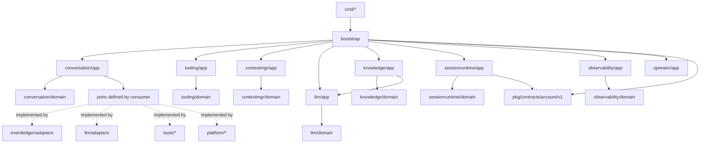

# 模块设计与接口契约

## 1. 仓库目录建议

```text
.
├── cmd/
│   ├── hub/                 # hub.exe 入口：控制面、进程管理、客户端 API
│   ├── sessiond/            # sessiond.exe 入口：单会话数据面
│   ├── startup/             # startup.exe：启动项与 hub 引导
│   └── tui/                 # tui.exe：终端客户端
├── pkg/
│   └── contracts/           # 跨进程公共契约；目录按领域+版本分包
│       ├── account/v1/      # Account DTO、Reader/Admin、method、错误码
│       ├── credential/v1/   # 短期 credential lease
│       ├── session/v1/      # 后续
│       ├── tool/v1/         # 后续
│       └── knowledge/v1/    # 后续
├── internal/
│   ├── bootstrap/           # 依赖装配、配置、版本、工具注册
│   ├── conversation/        # Conversation 限界上下文
│   ├── eventledger/         # 事件账本与 seq
│   ├── contextmgr/          # 上下文构建、压缩、token 估算
│   ├── tooling/             # 工具协议、Registry、执行运行时
│   ├── llm/                 # 账户、模型路由、provider 适配器
│   ├── knowledge/           # memory、BM25、向量、RRF、rerank
│   ├── sessionruntime/      # hub/sessiond 进程和 IPC
│   ├── observability/       # trace/stat 投影与查询
│   ├── operator/            # CLI/TUI 命令用例和读模型 DTO
│   └── platform/            # 进程、文件锁、凭据、启动项适配器
├── tools/                   # 默认工具适配器
│   ├── calculator/
│   ├── search/
│   ├── readdocs/
│   ├── todo/
│   ├── weather/
│   └── memory/
├── docs/agent-runtime/
├── go.mod
└── README.md
```

每个业务上下文内部按 `domain`、`app`、`ports`、`adapters` 组织。`domain` 不依赖基础设施；`ports` 由消费方定义需要的最小接口；`adapters` 实现文件、HTTP 或平台能力。

## 2. 依赖方向



依赖规则：

- `cmd` 只做参数解析、退出码和装配，不含业务逻辑。
- `bootstrap` 是唯一知道全部实现的地方，可创建具体 adapter；领域层只接收接口。
- `pkg/contracts` 只允许跨进程稳定 DTO/interface/method/error；任何 `internal/*` 不得被它 import。
- 不在实现方包定义“供所有调用方使用”的大接口；输入/输出 DTO 放清晰命名的共享契约包只在跨上下文稳定时使用。
- `tools/*` 不 import `conversation`；只实现 tooling 暴露的 handler 契约。
- memory 工具不直接拥有索引；通过调用方定义的 `KnowledgeClient` 访问 Hub KnowledgeService。
- `observability` 不反向驱动 conversation。

## 3. 可执行入口

### 3.1 `hub.exe`

建议子命令：

```text
hub serve
hub session create|list|inspect|start|stop|delete
hub run
hub status
hub tool call <session_id> /<toolname> <req>
hub llm account validate|smoke
hub daemon-shutdown
```

核心对象：

```go
type SessionProcess struct {
    SessionID  string
    PID        int
    Generation uint64
    State      ProcessState
    Transport  SessionTransport
}

type SessionManager interface {
    Create(ctx context.Context, spec CreateSession) (SessionRef, error)
    Start(ctx context.Context, id string) (SessionProcess, error)
    Stop(ctx context.Context, id string, grace time.Duration) error
    List(ctx context.Context) ([]SessionProcess, error)
    Route(ctx context.Context, id string, cmd Command) error
}
```

Hub 内部允许使用同步 map、锁、I/O goroutine；但不得把 Session 业务状态放进 hub 全局 map，也不得用 goroutine 作为会话生命周期边界。

Hub 同时托管共享 KnowledgeService、AccountStore 和能力路由；这些是跨会话基础设施，不改变 Session 的 seq/事件所有权。

Hub 对 Account 提供两个逻辑 surface：`Admin`（读+写，操作员鉴权）和 `Reader`（只读，Sessiond/Knowledge 使用）。Sessiond 构造参数只注入 `accountv1.Reader`；即使拿到具体 client，也没有管理写方法。

### 3.2 `sessiond.exe`

建议隐藏命令行：

```text
sessiond --session-id <id> --session-dir <path> --hub-token-fd <n>
```

它由 hub 启动，不接受普通用户直接连接。核心启动顺序：

1. 校验 session 参数和协议版本。
2. 获取独占 session lock。
3. 打开/校验 `messages.jsonl`，扫描最后合法 seq。
4. 重放待消费消息、turn 状态和最新压缩 checkpoint。
5. 创建 Actor 与各类运行时服务。
6. 通过 ready 握手通知 hub。
7. 处理命令，直到收到 stop 或不可恢复错误。

### 3.3 `startup.exe`

建议子命令：

```text
startup run                 # 幂等启动 hub，供登录项使用
startup install             # 安装当前用户级启动项
startup uninstall
startup status
```

启动项实现放在 `platform/startup`：Windows 使用当前用户启动目录快捷方式或注册表 `Run`，Linux 使用 XDG autostart，macOS 使用 LaunchAgent。具体选择由平台 adapter 实现，CLI 不感知。

### 3.4 `tui.exe`

建议子命令/导航：

```text
tui
tui sessions
tui chat <session>
tui trace <session> [--call-id]
tui stats <session>
tui accounts
tui compress <session> [--through-seq N]
```

首版 TUI 自实现：

- 终端尺寸探测和窗口 resize；
- ANSI/Windows console 屏幕绘制；
- 键盘事件与文本输入；
- 通过 Hub client 订阅事件；
- 重连后按最后展示的 `seq` 补拉。

TUI 不包含 LLM/tool 运行时，不持久化权威业务状态。

## 4. Conversation 模块

### 4.1 Actor 命令

```go
type ActorCommand interface {
    isActorCommand()
}

type AcceptUserMessage struct {
    MessageID    string
    Text         string
    QueuePolicy  QueuePolicy
    Idempotency  string
}

type DirectToolCallRequest struct {
    RequestID    string
    ToolName     string
    RawRequest   string
    Idempotency  string
}

type ModelCompleted struct {
    TurnID     string
    RequestID  string
    Response   ModelResponse
    ReceivedAt time.Time
}

type ToolCompleted struct {
    TurnID string
    CallID string
    Result ToolResult
}

type CancelTurn struct {
    TurnID string
    Reason string
}

type RequestCompression struct {
    Trigger         CompressionTrigger
    RequestedSeq    *int64
    KeepTailEvents  int
}
```

Actor 每次只处理一个命令：

1. 校验命令版本和会话状态。
2. 产生一个或多个事件草稿。
3. 通过唯一 EventAppender 提交。
4. 更新内存聚合和队列。
5. 发布通知给 hub。

网络回调和工具回调不能绕过此流程。Actor 本身可以阻塞在一个短事务上，但长 I/O 由 sessiond 内部的下层调用发起；回调重新入队，避免外部调用直接改变会话状态。

`DirectToolCallRequest` 由 Hub 服务端解析 `/toolname req` 后发送。Actor 先提交 `user.tool_command.accepted`，再创建 `kind=direct_tool` 的 turn/trace；Tool Runtime 先尝试 JSON 请求，再回到工具注册的 DirectRequestAdapter。

### 4.2 ReAct Loop

```go
type LoopDecision interface {
    isLoopDecision()
}

type RequestModel struct {
    Context ContextView
    Model   ModelSelection
}

type InvokeTool struct {
    Call ToolCall
}

type FinishTurn struct {
    Answer Answer
}

type ReActLoop interface {
    Next(ctx context.Context, state TurnState) (LoopDecision, error)
}
```

规则：

- 每轮先判断压缩预检。
- 模型工具调用由模型提出；Slash 直调不经过模型，但同样校验工具存在、schema 合法和权限允许。
- 每个工具结果以结构化 `ToolResult` 返回，不把原始异常直接拼进 prompt。
- 直调结果直接返回客户端，不隐式追加第二次 LLM 请求。
- `MaxSteps`、最大上下文、最大工具失败重试次数由构造配置注入。
- ReAct Loop 不直接 append event；它返回决策，Actor/Application Service 提交对应事件。

## 5. Event Ledger 模块

```go
type Draft struct {
    Type          EventType
    TraceID       string
    CausationSeq  int64
    CallID        string
    Visibility    Visibility
    Payload       any
}

type Appender interface {
    Append(ctx context.Context, d Draft) (Ref, error)
}

type Reader interface {
    ReadRange(ctx context.Context, after int64, limit int) ([]Event, error)
    LastCommitted(ctx context.Context) (int64, error)
}
```

实现要求：

- 单 sessiond 单写者；写锁覆盖 `last_seq -> seq+1 -> encode -> append -> flush -> fsync -> acknowledge`。
- 每条事件必须是单次完整 JSONL 行；禁止多行 pretty JSON。
- 参数在写入前做大小限制和脱敏。
- 启动时校验 schema、event id 与连续 seq。
- 可选的 snapshot 只加速读取，不改变事件流。
- 写入错误保持 sessiond 为 failed/retryable，不能继续向模型发送“已提交”假状态。

## 6. Context Management 模块

```go
type ContextBuilder interface {
    Build(ctx context.Context, sessionID string, upTo int64, budget Tokens) (ContextView, error)
}

type CompressionPolicy interface {
    Decide(ctx context.Context, input CompressionInput) (CompressionPlan, error)
}

type Summarizer interface {
    Summarize(ctx context.Context, source ContextSource) (Summary, error)
}
```

关键对象：

- `TokenEstimator`：可替换的 token 估算策略；首版可用保守字符/字节估算。
- `SafeCutoffResolver`：按事件边界选出安全 `red_line_seq`。
- `CompressionPolicy`：自主阈值（`autonomous`）或外部触发（`external`）。
- `CompressionService`：预检、提交 requested 事件、摘要、校验、提交 completed/failed 事件。

压缩的权威结果事件由 Actor 提交；压缩组件不直接写账本。

## 7. Tooling 模块

### 7.1 注册契约

```go
type ToolSpec struct {
    Name               string
    Version            string
    Kind               ToolKind // local | remote | mutating | memory
    Description        string
    Parameters         json.RawMessage
    DirectRequestField string
    ReadOnly           bool
    Timeout            time.Duration
    Capabilities       []string
    Idempotent         bool
}

type ToolHandler interface {
    Invoke(ctx context.Context, call Call) (Result, error)
}

type DirectRequestAdapter interface {
    Adapt(raw string) (json.RawMessage, error)
}

type Registry interface {
    Register(spec ToolSpec, handler ToolHandler) error
    Resolve(name, version string) (RegisteredTool, error)
    List() []ToolSpec
}

type ToolError struct {
    Code       string
    Message    string
    Retryable  bool
    Scope      string
    Provider   string
    RequestID  string
    ResetAt    *time.Time
    Details    map[string]any
}

type ToolTiming struct {
    QueueMS      int64
    ValidationMS int64
    ExecuteMS    int64
    TotalMS      int64
}
```

注册时必须执行：

1. 名称非空、大小写和版本规范化。
2. 参数 schema 可解析且属于受支持 JSON Schema 子集。
3. handler 非空。
4. 同 name/version 重复注册报错。
5. 工具类型、超时、幂等要求和权限标签齐全。
6. 依赖构造已注入，禁止全局 registry singleton。
7. DirectRequestAdapter 存在时，必须声明原始文本映射到 schema 的主字段。

### 7.2 默认工具矩阵

| 工具名 | Kind | 输入要点 | 输出/副作用 | 失败重点 | 测试替身 |
|---|---|---|---|---|---|
| `calculator` | local | 受限算术表达式 | 数值结果；无副作用 | 非法字符、除零、溢出 | 直接单测 |
| `search` | remote | `query`、`limit` | 搜索结果；无本地副作用 | 鉴权、额度、限流、超时、空结果 | fake search server |
| `read_docs` | local | 根 ID、相对路径、行范围 | 文档片段；只读 | 越界、不存在、编码错误 | 临时目录 |
| `todo` | mutating | action、item、id、idempotency_key | Todo 增改查；有副作用 | 冲突、重复写、非法状态 | 临时 store |
| `todo_board` | mutating | action、id/title/details/status/priority、expected_version、idempotency_key | 当前 Session 的运维 board；CRUD 与 tombstone | not_found、版本冲突、非法流转、持久化失败 | 临时 board store |
| `weatherapi` | remote | location、date | 天气结果；无本地副作用 | 超时、上游 5xx、无数据 | fake weather server |
| `memory_write` | mutating | scope、text、metadata、idempotency_key | BM25+dense 索引完成后发布 memory record | 冲突、embedding 额度、维度、非法 scope | 临时 knowledge store |
| `memory_search` | memory | query、scope、limit、rerank 开关 | hybrid top-K + 通道排名/模型版本 | 空索引、embedding/rerank 额度、超时 | fake embedding/rerank |
| `memory_update` | mutating | record_id、patch、expected_version | 新版本 record | not_found、版本冲突、权限 | 临时 store |

这九个工具的注册、列目录和至少一个成功/失败调用，是 Registry 的首要验收用例。
其中 `todo_board` 的 store 路径必须由 Sessiond 从当前 `SessionDir` 构造，
不能接受调用方传入 board 路径或跨 Session ID。

### 7.3 执行管道

```text
resolve -> parse direct JSON/DirectRequestAdapter -> validate args -> authorize
        -> record requested + queue timestamp
        -> timeout/cancel-wrap -> handler.Invoke -> measure monotonic time
        -> normalize result/ToolError -> record completed/failed + timing
        -> return structured result to model/direct caller
```

工具调用事件由 Tool Runtime 产生草稿并交给 Actor，不由具体工具实现负责。失败分类映射为稳定错误码；provider 原始报错只放脱敏诊断字段。成功、失败、超时、取消都必须记录 timing。

## 8. LLM Access 模块

```go
type Repository interface {
    LoadAll(ctx context.Context) ([]domain.Account, error)
    Find(ctx context.Context, id string) (domain.Account, error)
    Update(ctx context.Context, expectedRevision uint64, mutate func(*domain.Account) error) (domain.Account, error)
    Archive(ctx context.Context, ref accountv1.AccountRef) error
}

type CredentialStore interface {
    Resolve(ctx context.Context, ref CredentialRef) (string, error)
}

type ModelClient interface {
    Complete(ctx context.Context, req Request) (Response, error)
}

type EmbeddingClient interface {
    Embed(ctx context.Context, texts []string) (EmbeddingBatch, error)
}

type RerankClient interface {
    Rerank(ctx context.Context, req RerankRequest) (RerankResponse, error)
}

type ClientFactory interface {
    NewChat(account Account, binding ServiceBinding, credential Secret) (ModelClient, error)
    NewEmbedding(account Account, binding ServiceBinding, credential Secret) (EmbeddingClient, error)
    NewRerank(account Account, binding ServiceBinding, credential Secret) (RerankClient, error)
}
```

公共 `pkg/contracts/account/v1` 定义 `Reader`、`Admin`、DTO、method 和错误码；Hub AccountApplication 实现两者，内部 Repository 不暴露给 Sessiond。Sessiond 构造只接受 `accountv1.Reader`。完整角色矩阵见 [Account 公共契约与模块角色用例](11-account-contract-and-role-usecases.md)。

账户配置示例（完整 JSONL 见 [config/llm-accounts.example.jsonl](../../config/llm-accounts.example.jsonl)）：

DeepSeek chat/tool-call 最小配置：

```json
{
  "chat": {
    "api_key_env": "DEEPSEEK_API_KEY",
    "thinking": {"type": "enabled"},
    "reasoning_effort": "high"
  }
}
```

未填写的 provider/protocol/base_url/path/model/timeout 自动规范化为
`deepseek`、`openai_compatible`、`https://api.deepseek.com`、
`/chat/completions`、`deepseek-flash` 和 120 秒。`api_key_env` 只保存变量名，
请求时通过 credential lease 解析。

```json
{
  "schema_version": 1,
  "account_id": "embedding-main",
  "revision": 1,
  "enabled": true,
  "default_for": ["embedding"],
  "services": {
    "embedding": {
      "provider": "openai-compatible",
      "protocol": "openai_embeddings_v1",
      "base_url": "https://your-embedding-provider.example/v1",
      "path": "/embeddings",
      "model": "your-embedding-model",
      "credential_ref": "env:EMBEDDING_API_KEY",
      "dimensions": 1536,
      "batch_size": 32,
      "normalize": true,
      "timeout": "60s"
    }
  }
}
```

规则：

- 账户元数据持久化；明文密钥只由 `CredentialStore` 提供。
- capability 各自选择账户/binding；不能把 chat 账户盲目复用为 embedding/rerank。
- Hub 管理面注入 `accountv1.Admin`；Sessiond、LLM Gateway 和 KnowledgeService 只注入 `accountv1.Reader`。
- Sessiond IPC token 仅含 `account:read`，服务端 method allowlist 拒绝所有 `account.admin.*` 写方法。
- 账户选择记录 `account_id`、revision、capability、model 和安全 endpoint alias，不能把完整配置复制到事件。
- `llm account validate` 校验 JSONL/schema/revision；`smoke` 对真实 API 做 opt-in 探测，不向会话事件流写测试事件。
- `llm account remove` 先检查引用，确认后仅删除配置；不删除历史事件中已记录的 account_id。
- provider 适配器只接受归一化请求，不允许业务模块感知 SDK 专有结构。
- 真实账号文件、密钥和 smoke 报告使用 `.gitignore` 排除；示例只提交安全占位 endpoint。

## 9. Knowledge Retrieval 模块

Hub 托管共享 KnowledgeService，Sessiond 的 memory tool handler 通过本地 `KnowledgeClient` 调用。

```go
type KnowledgeClient interface {
    Write(ctx context.Context, record MemoryRecord) (MemoryRef, error)
    Update(ctx context.Context, req UpdateMemory) (MemoryRef, error)
    Search(ctx context.Context, query HybridQuery) (HybridResult, error)
}

type LexicalIndex interface {
    Upsert(ctx context.Context, chunks []IndexedChunk) error
    Delete(ctx context.Context, chunkIDs []string) error
    Search(ctx context.Context, query string, limit int) ([]LexicalHit, error)
    Snapshot(ctx context.Context) (IndexManifest, error)
}

type HybridRetriever interface {
    Retrieve(ctx context.Context, query string, scope Scope, limit int) (HybridResult, error)
}
```

BM25 必须自行实现：

- `Tokenizer`：默认 Latin term + CJK unigram/bigram。
- 倒排表：`token -> postings {chunk_id, tf}`。
- IDF、`k1=1.2`、`b=0.75`、doc length 和 avgdl。
- 稳定 tie-break、原子 index snapshot、更新/删除。

混合检索默认取 BM25 top 50 与 dense top 50，通过 RRF 融合，再用 rerank binding 对前 20 重排。返回结果必须包含通道排名、融合分、rerank 分、index version、embedding fingerprint、降级 warning 和各阶段耗时。

详细算法、失败策略和测试见 [工具请求、异常、耗时与混合记忆检索](10-tool-requests-and-hybrid-memory.md)。

## 10. Session Runtime 模块

```go
type ProcessLauncher interface {
    Start(ctx context.Context, spec LaunchSpec) (ProcessHandle, error)
    Signal(handle ProcessHandle, signal StopSignal) error
    Wait(handle ProcessHandle) ExitStatus
}

type SessionTransport interface {
    Send(ctx context.Context, frame Frame) error
    Receive(ctx context.Context) (Frame, error)
    Close() error
}

type LeaseStore interface {
    Acquire(ctx context.Context, sessionID string, owner ProcessIdentity) (Lease, error)
    Release(ctx context.Context, lease Lease) error
}
```

Hub 内存中维护进程表，但持久化 `session_dir/session.lock` 与 `sessiond.json` 作为双写防护和重连发现依据。`generation` 防止旧 sessiond 在重启后误接收路由。业务连接不得使用父子 stdio，否则 hub 崩溃会切断 sessiond。

禁止将 sessiond 进程管理器设计为每会话一个 goroutine 管理循环；hub 可以用事件驱动 I/O，但进程对象和状态迁移由 hub 的进程表管理。

## 11. Observability 模块

```go
type TraceQuery interface {
    ByCall(ctx context.Context, sessionID, callID string) (TraceView, error)
    ByTurn(ctx context.Context, sessionID, traceID string) (TraceView, error)
}

type StatsQuery interface {
    ToolSummary(ctx context.Context, filter StatsFilter) ([]ToolStat, error)
}
```

最小统计维度：

- `tool_name`
- `tool_kind`
- `invocation_mode`
- `status`
- `reason_code`
- `count`
- `first_seq` / `last_seq`
- 成功率、平均/P50/P95 total/execute 耗时
- memory 检索的 channel counts、index version、embedding/rerank model、degraded 原因

查询端必须能区分“投影已追平”与“投影落后”。统计不是独立事实源，重建逻辑与测试必须独立于实时写入路径。

## 12. Operator/TUI 模块

Hub client 抽象：

```go
type ControlClient interface {
    CreateSession(ctx context.Context, req CreateSession) (SessionView, error)
    Submit(ctx context.Context, sessionID, text string) (TurnRef, error)
    InvokeTool(ctx context.Context, sessionID, rawCommand string) (ToolResultView, error)
    Snapshot(ctx context.Context, sessionID string, tailLimit int) (SessionSnapshot, error)
    History(ctx context.Context, sessionID string, beforeSeq int64, limit int) (EventPage, error)
    Watch(ctx context.Context, sessionID string, afterSeq int64, wait time.Duration) (EventPage, error)
    QueryTrace(ctx context.Context, sessionID, traceID string) (TraceView, error)
    QueryStats(ctx context.Context, filter StatsFilter) ([]ToolStat, error)
    ListAccounts(ctx context.Context, capability Capability) ([]AccountView, error)
}
```

TUI 的视图状态只保存展示 cursor 和窗口布局；真实会话状态每次从 Hub 读模型获取或从 `event_committed` 事件推进。TUI 不将临时输出当历史事实。

当前 TUI 缓存使用 tail+older 两段窗口：snapshot 刷新只替换 tail，history
把更早页合入 older，合并后按 seq 升序去重。`ApplyIncremental` 只接受 tail
末行之后的连续 seq；出现空洞时不猜测，设置 `resync_required` 并重新快照。
进程 snapshot 的 `running/idle` 不能推断当前 turn 状态，turn 运行态只由
`turn.started` 与 `turn.completed` 事件更新。

TUI 输入以 `/` 开头时调用 `InvokeTool` 并由服务端最终解析。TUI 可本地补全已注册工具，但不得绕过 Hub/Sessiond 的工具授权。工具异常、进度和耗时展示来自 `tool.requested/completed/failed` 事件。

## 13. 平台适配

| 端口 | Windows | Linux/macOS |
|---|---|---|
| Process launcher | `os/exec` + Job Object/进程组 | `os/exec` + process group |
| Startup item | 用户启动目录或 HKCU Run | XDG autostart / LaunchAgent |
| File lock | 独占打开/平台锁 | advisory lock |
| Credential | Windows Credential Manager adapter 或 env | Secret Service/Keychain adapter 优先，v1 可 env |
| Terminal | Windows console mode + ANSI | termios + ANSI |

所有平台差异在 `platform/*` 下通过 build tags 隔离；领域、Convo、Tooling 代码不能出现 `runtime.GOOS` 分支。

## 14. 装配与启动

```text
main(hub)
  -> load config
  -> load/validate accounts.jsonl and credential refs
  -> load/rebuild KnowledgeService indexes
  -> install process/lease adapters
  -> start hub control API
  -> load persisted session index
  -> reconcile live sessiond processes
  -> wait commands

main(sessiond)
  -> validate session spec
  -> acquire session lock
  -> open ledger / replay
  -> create context/tool/llm/knowledge-client/governance services
  -> create Actor with a single serial command queue
  -> ready handshake
  -> serve until stop/fatal
```

启动顺序错误会导致双写或读取半提交状态，编码时必须用 integration test 覆盖。
