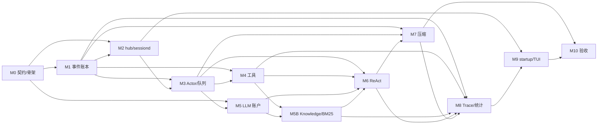
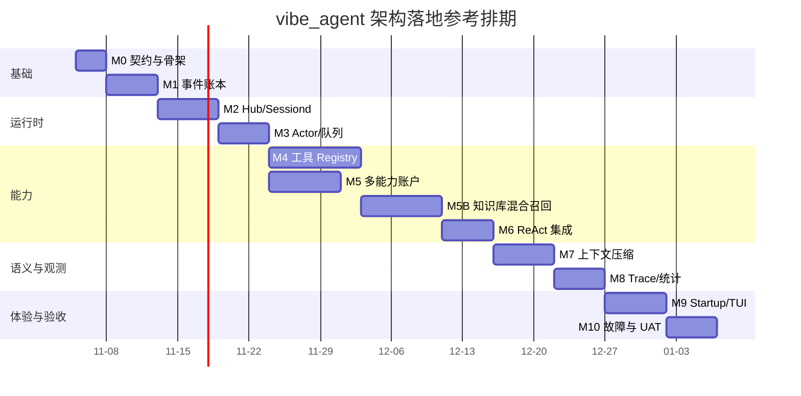

# 里程碑与开发看板

## 1. 交付策略

实现顺序遵循“先证明真相源，再接入能力，再做体验”：

```text
契约和可执行骨架
  -> JSONL + seq
  -> hub/sessiond 生命周期
  -> Actor 队列与恢复
  -> 工具/LLM 能力
  -> 压缩
  -> trace/统计/TUI/启动项
  -> 故障注入与 UAT
```

任何里程碑未通过其验证门禁，不进入依赖它的后续里程碑。尤其不能先做漂亮的 TUI 再补 seq 和恢复语义。

## 2. 当前看板

状态定义：

- **Backlog**：尚未满足 Ready 条件。
- **Ready**：依赖和验收标准明确，可开始。
- **In Progress**：正在实现。
- **Verify**：代码完成，正在执行验证。
- **Done**：代码、测试、文档和回滚点全部完成。

| Backlog | Ready | In Progress | Verify | Done |
|---|---|---|---|---|
|  |  |  |  | M0 契约/骨架<br>M1 事件账本<br>M2 Hub/Sessiond 生命周期<br>M3 Actor/队列<br>M4 工具 Registry<br>M5 多能力账户<br>M5B Knowledge 混合召回<br>M6 ReAct<br>M7 压缩<br>M8 Trace/Stats<br>M9 startup/TUI<br>M10 故障与 UAT |

当前环境已通过本地 build/test/vet/race、package README、contracts/Sessiond
依赖门禁和 Windows 四 exe UAT。GitHub hosted CI 需在用户提交并 push 后执行；
本轮遵守“不自动 commit/push”要求。

## 3. 里程碑卡片

### M0：架构契约与四入口骨架

| 项 | 内容 |
|---|---|
| 估算 | 2–3 个工程日 |
| 依赖 | 无 |
| 交付 | `cmd/hub`、`cmd/sessiond`、`cmd/startup`、`cmd/tui` 可构建；`pkg/contracts` 版本化公共包、模块目录、错误码、版本握手、ADR 初稿 |
| 验证 | 四个二进制构建通过；`--version`/`--help` 可用；包依赖无循环；配置缺省可启动 hub 的 dry-run |
| Exit | R-016、R-017 的静态结构和构建检查通过 |

### M1：事件账本、连续 seq 与重放

| 项 | 内容 |
|---|---|
| 估算 | 4–5 个工程日 |
| 依赖 | M0 |
| 交付 | 事件信封、单写者 Append、JSONL 校验、最后合法 seq 恢复、基本 Reader、重放快照 |
| 验证 | 并发注入命令下 seq 连续；两会话独立；末尾半行损坏测试；删除投影可重建 |
| Exit | R-008、R-009；NFR-002、NFR-004 的事件层测试通过 |

### M2：hub.exe 与 sessiond.exe 生命周期

| 项 | 内容 |
|---|---|
| 估算 | 5–6 个工程日 |
| 依赖 | M1 |
| 交付 | Hub 单实例、进程表、framed IPC、sessiond 启动握手、session lock、优雅停止、崩溃重启、孤儿对账 |
| 验证 | 创建 A/B 两个会话对应两个 sessiond；杀掉 A 的 sessiond 不影响 B；hub 重启后重新 attach 存活 sessiond 并重建进程表；重复启动不能双写 |
| Exit | R-019；NFR-001、NFR-003、NFR-008 的进程级测试通过 |

### M3：Session Actor、待发送队列与 turn 状态机

| 项 | 内容 |
|---|---|
| 估算 | 4–5 个工程日 |
| 依赖 | M1、M2 |
| 交付 | 单会话命令调度、PendingMessage、queue/cancel-and-queue、turn 生命周期、取消与超时、恢复队列 |
| 验证 | LLM/tool 挂起时接收新消息；重启后 accepted-not-consumed 仍在；两个 turn 不并发；取消后事件链完整 |
| Exit | R-010、R-011 的状态与恢复测试通过 |

### M4：工具 Registry、Slash 直调与八个默认工具

| 项 | 内容 |
|---|---|
| 估算 | 8–9 个工程日 |
| 依赖 | M1、M3 |
| 交付 | ToolSpec/handler/registry、`/toolname req` 解析、统一 ToolError、排队/执行耗时、calculator、search、read_docs、todo、weatherapi、memory proxies |
| 验证 | 注册重复名失败；列目录八个工具；模型调用与直调共享运行时；未知工具、非法参数、quota、timeout 有结构化错误；read_docs 越界被拒 |
| Exit | R-001 至 R-007、R-021 至 R-023；NFR-005、NFR-009、NFR-012 的工具层测试通过 |

### M5：多能力账户管理与模型适配

| 项 | 内容 |
|---|---|
| 估算 | 6–7 个工程日 |
| 依赖 | M0、M3 |
| 交付 | `pkg/contracts/account/v1` 公共契约、Hub Admin/Sessiond Reader、JSONL AccountStore、revision、CredentialRef、多能力 binding、Chat/Embedding/Rerank adapters、validate/smoke CLI |
| 验证 | Hub 可读写；Sessiond 只读且调用写方法被拒绝；账户示例可加载；revision/额度/维度错误稳定；模型 smoke 无 key 泄漏 |
| Exit | R-018、R-026、R-027；NFR-005、NFR-012、NFR-013；账户权限与 smoke 矩阵通过 |

### M5B：Knowledge、BM25 与混合召回

| 项 | 内容 |
|---|---|
| 估算 | 7–9 个工程日 |
| 依赖 | M4、M5 |
| 交付 | memory record/chunk、自研 tokenizer/BM25/index、embedding fingerprint、dense cosine、RRF、reranker、strict/degraded 策略 |
| 验证 | BM25 手算对拍；CJK 召回；更新/删除后 index 一致；两通道融合；维度不匹配/quota 错误；索引重建与原子快照 |
| Exit | R-024、R-025；NFR-011；memory_write/search/update 端到端通过 |

### M6：ReAct Loop 集成

| 项 | 内容 |
|---|---|
| 估算 | 4–5 个工程日 |
| 依赖 | M3、M4、M5、M5B |
| 交付 | 带工具目录的模型请求、工具提议、工具结果回灌、memory recall、最大步数、错误重试策略、最终回答与 turn 完成事件 |
| 验证 | 至少一条多步工具链和一条 memory recall；工具 quota 可反馈模型；直调与模型调用均入 trace；达到步数上限安全终止 |
| Exit | R-010、R-014、R-021 的事件链集成测试通过 |

### M7：基于 seq 红线的上下文压缩

| 项 | 内容 |
|---|---|
| 估算 | 5–6 个工程日 |
| 依赖 | M1、M3、M6 |
| 交付 | ContextBuilder、TokenEstimator、SafeCutoffResolver、自主策略、非自主压缩命令、checkpoint 重建 |
| 验证 | 不切断 pending tool；不吞未消费消息；自主/非自主共用服务；压缩失败不推进水位；重启后有效上下文一致 |
| Exit | R-012、R-013；所有压缩边界测试通过 |

### M8：trace、统计与 Hub 查询面

| 项 | 内容 |
|---|---|
| 估算 | 4–5 个工程日 |
| 依赖 | M1、M4、M5B、M6、M7 |
| 交付 | trace 索引、tool stats、invocation mode、quota/失败原因、avg/P50/P95 耗时、retrieval metadata、CLI/TUI 查询 API |
| 验证 | 删除索引后重建相同结果；in-flight/orphaned 不误计成功；耗时可重放；两会话相同 seq 不串链 |
| Exit | R-014、R-015、R-023；NFR-004 的投影重建测试通过 |

### M9：startup.exe 与 TUI

| 项 | 内容 |
|---|---|
| 估算 | 5–6 个工程日 |
| 依赖 | M2、M8 |
| 交付 | 登录启动项安装/检查/移除、幂等拉起 hub、TUI 会话列表/聊天/工具状态/trace/压缩/账户页面 |
| 验证 | startup 可重复运行且只产生一个 hub；TUI 断线重连同 seq 恢复；TUI 不直接访问 sessiond/JSONL |
| Exit | R-020；手工 UAT 脚本通过 |

### M10：故障注入、性能与发布验收

| 项 | 内容 |
|---|---|
| 估算 | 4–5 个工程日 |
| 依赖 | M1–M9（含 M5B） |
| 交付 | 故障矩阵、20 会话压力测试、race/fuzz、日志脱敏、发布包、回滚步骤、运维文档 |
| 验证 | 关键崩溃点恢复；20 个 sessiond 隔离；无 data race；无 goroutine/文件句柄泄漏；UAT 全部通过 |
| Exit | 所有 P0 需求达到 Done；V 模型验收矩阵关闭 |

## 4. 关键依赖图



可并行点：M4 与 M5 在 M1/M3 完成后可以并行；M8 的原始事件聚合基础可在 M2 后开始，但最终统计必须等工具事件契约稳定。

## 5. 参考排期

以下为单名熟悉 Go 的工程师基线，不含外部 API 接入等待：



单线程日历约 14–15 周；M4/M5 并行后约 12–13 周。排期是容量估计，不是交付承诺。

## 6. Ready / Done 标准

### Ready

- 对应需求 ID 和验收测试已列出。
- 输入/输出接口和错误码已明确。
- 依赖里程碑已在 Done。
- 需要真实外部 API 的部分已有 fake server 或录制方案。
- 数据迁移/兼容策略明确（首个版本可为“无迁移”）。

### Done

- 代码已合并，相关测试通过。
- P0 验收标准有自动化测试或明确手工步骤。
- 涉及并发/进程的路径运行 `-race -count=3`。
- trace 包含 session_id/seq，日志完成脱敏。
- 相关文档、ADR、命令帮助同步更新。
- 回滚点已记录；没有未说明的跨模块临时 hack。

## 7. 风险看板

| 风险 | 影响 | 当前状态 | 缓解 |
|---|---|---|---|
| Windows 下进程组/孤儿回收差异 | sessiond 残留或重复写 | Open | 自动测试杀 hub/sessiond；session lock + generation + 启动对账 |
| hub/sessiond IPC 死锁或半帧 | 会话卡死 | Open | 长度上限、读写超时、frame id、集成测试 |
| 会话崩溃后有副作用工具状态未知 | 重复执行 | Open | call_id + idempotency_key + reconcile 查询 |
| fsync 性能与持久性权衡 | 延迟高或丢最后事件 | Open | 可配置 durability policy，但确认前不发送依赖事件 |
| 压缩切在错误边界 | 上下文丢失/工具配对断裂 | Open | 安全切割算法与专门边界测试 |
| DeepSeek Search/Weather 协议变化 | 工具不可用 | Open | adapter 隔离、fake server、稳定错误码 |
| embedding/reranker 额度或协议变化 | memory 召回失败 | Open | Capability binding、probe、strict/degraded、smoke |
| BM25 中文分词/索引正确性 | 召回质量不稳定 | Open | 自研 tokenizer 基线、手算对拍、更新/删除测试 |
| embedding model/维度漂移 | 新旧向量混检 | Open | model fingerprint + index rebuild |
| TUI 终端差异 | 显示错乱 | Open | 抽象 terminal adapter，Windows 优先，ANSI fallback |
| 密钥误入日志/事件 | 安全泄漏 | Open | CredentialRef、结构化脱敏、测试扫描 |
