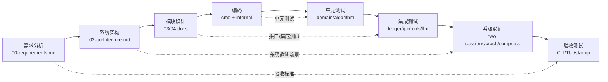

# V 模型与需求追溯矩阵

## 1. V 模型



左臂每下降一层，必须增加可验证的接口和约束；右臂每上升一层，必须回指到左侧对应产物。实现完成后，右臂不能只凭“手工看起来正常”关闭。

## 2. 阶段产物与门禁

| 左侧阶段 | 产物 | 对应右侧验证 | 门禁 |
|---|---|---|---|
| 用户需求 | R/NFR、非目标、验收标准 | UAT 场景 | 需求无歧义，P0 可度量 |
| 系统设计 | 四 exe 拓扑、事件真相源、hub/sessiond 边界 | System Validation | 两会话、崩溃、恢复、trace 端到端场景明确 |
| 模块设计 | 模块目录、端口、错误码、事件目录 | Integration Test | 依赖无环；接口可注入 fake |
| 详细设计与编码 | 具体类型、算法、命令处理 | Unit Test | 关键不变式可独立测试 |
| 发布 | 版本、迁移、启动项、回滚 | Acceptance | UAT 与发布清单通过 |

## 3. 功能需求追溯

| 需求 | 架构/设计落点 | 自动化测试 | 系统/UAT 场景 | 里程碑 |
|---|---|---|---|---|
| R-001 工具注册 | `tooling/registry`、ToolSpec | `TestRegisterDuplicateFails`、`TestSchemaValidation`、`TestListTools` | `tool list` 显示八个工具 | M4 |
| R-002 calculator | `tools/calculator` | `TestCalculatorSuccessAndErrors` | 模型调用计算器得到正确结果 | M4 |
| R-003 search | `tools/search`、DeepSeek adapter | `TestSearchSuccess/Timeout/RateLimit` | 假服务端到端搜索 | M4 |
| R-004 read_docs | `tools/readdocs` | `TestReadDocsTraversalDenied`、`TestLineRange` | 仅能读允许根目录 | M4 |
| R-005 todo | `tools/todo` | `TestTodoIdempotency`、`TestTodoStateTransitions` | 创建、更新、完成、重启可读 | M4 |
| R-006 weatherapi | `tools/weather` | `TestWeatherSuccess/UpstreamFailure` | 模型根据天气结果回答 | M4 |
| R-007 memory 三工具 | `tools/memory`、KnowledgeClient | `TestMemoryWriteSearchUpdate`、`TestVersionConflict` | 写入后 hybrid 召回、更新后版本正确 | M4/M5B |
| R-008 事件 seq | event envelope、single writer | `TestEveryEventGetsNextSeq`、`TestLLMToolEventsHaveSeq` | trace 中工具/模型事件都有 seq | M1/M6 |
| R-009 会话独立与真相源 | sessiond + Event Ledger | `TestSessionsStartAtOneIndependently`、`TestReplayRestoresState` | 两个会话并发交互后重启 | M1/M2 |
| R-010 ReAct Loop | conversation Loop state machine | `TestLoopToolThenModel`、`TestMaxSteps` | 用户问题触发工具并再次模型 | M6 |
| R-011 待发送队列 | Actor queue、accepted/consumed events | `TestQueueWhileModelInFlight`、`TestRecoverPendingQueue` | 长调用期间连续发送，重启后继续 | M3 |
| R-012 压缩红线 | CompressionService、SafeCutoffResolver | `TestCutoffCannotSplitToolCall`、`TestCheckpointReplay` | 自动压缩后继续对话且历史一致 | M7 |
| R-013 自主/非自主压缩 | CompressionPolicy + command | `TestAutonomousTrigger`、`TestExternalThroughSeq` | CLI/TUI 非自主压缩、阈值自主压缩 | M7 |
| R-014 Trace | causation_seq、call_id、TraceQuery | `TestTraceByTraceID`、`TestTraceByCallID` | 查看多步工具调用链 | M8 |
| R-015 统计 | ToolStats/Latency projector | `TestToolStatsAndFailures`、`TestToolLatencyPercentiles`、`TestProjectionRebuild` | 调用、超时、额度不足后次数/原因/P95 正确 | M8 |
| R-016 无 Agent 框架 | dependency/package rule | CI dependency guard | 检查无编排框架 | M0/M10 |
| R-017 Go CLI | `cmd/*` | command help/exit-code tests | 所有必需子命令可用 | M0/M9 |
| R-018 账户 | llm AccountStore/CredentialRef | `TestAccountValidation`、`TestRevisionConflict`、`TestNoSecretInEvents` | 切换账户后新请求用新账户 | M5 |
| R-019 固定进程拓扑 | hub ProcessManager + sessiond | `TestOneSessiondPerSession`、`TestCrashIsolation` | 20 会话进程隔离 | M2/M10 |
| R-020 启动项与 TUI | startup platform adapter、TUI client | startup idempotency tests、TUI reducer tests | 登录式启动、TUI 会话切换和重连 | M9 |
| R-021 Slash 工具请求 | operator parser + Tool Runtime | `TestDirectToolTurn`、`TestUnknownTool`、`TestDirectSchemaError` | TUI 输入 `/calculator 1+2*3` 与 `/search ...` | M4/M9 |
| R-022 工具异常 | ToolError + provider mapping | `TestQuotaError`、`TestRateLimitError`、`TestAuthAndTimeout` | API 额度不足时 TUI/trace 显示 quota_exhausted | M4/M5 |
| R-023 工具耗时 | monotonic timer + event timing | `TestToolTimingSuccessFailure`、`TestTimingReplay` | trace/stats 显示 queue/execute/total/P95 | M4/M8 |
| R-024 BM25 | knowledge/bm25 | `TestBM25Formula`、`TestCJKTokenizer`、`TestIndexUpdateDelete` | 小型语料排名与手算一致 | M5B |
| R-025 混合召回 | hybrid retriever/RRF/rerank | `TestRRFFusion`、`TestHybridStrictAndDegraded` | memory_search 显示 BM25/dense/rerank 通道 | M5B |
| R-026 Embedding/Rerank 账户 | capability binding + adapters | `TestEmbeddingDimensions`、`TestRerankTopN`、`TestCapabilitySelection` | 真实 embedding/rerank smoke | M5 |
| R-027 Account 公共契约与角色 | `pkg/contracts/account/v1`、Hub Admin/Sessiond Reader | `TestAccountReaderCannotCallAdmin`、`TestSessiondWriteTokenDenied`、`TestResolveMinimizesView` | Hub 可管理账户，Sessiond 只能读取并调用 API | M5 |
| R-028 可恢复会话观察 | `session/{snapshot,watch,history}`、`operator/sessioncache` | `TestWatchWakesAfterCommittedEvent`、`TestSnapshotPreservesOlderAndDeduplicatesSeam`、`TestWaitForMessageTurnReconnectsWithCursor` | `smoke-chain.ps1` 验证 A/B 快照、水位、分页、超时和 seq 隔离 | M9/M10 |
| R-029 会话 Todo Board | `tools/todo/board.go`、Sessiond Registry、TUI `/board` | `TestBoardCRUDLifecycleAndPersistence`、`TestBoardIdempotencyAndVersionConflict`、`TestTodoBoardIsIsolatedPerSessionDirectory`、`TestSystemPromptSummarizesBoardSchema` | hidden PTY 验证 create/list/update/get/delete 和最终空 board | M4/M9/M10 |

## 4. 非功能追溯

| NFR | 设计措施 | 验证 |
|---|---|---|
| NFR-001 会话隔离 | 每 Session 一个 sessiond；hub 只路由 | 20 会话并发；kill 单 sessiond |
| NFR-002 顺序正确性 | 单 Actor/单写者；seq 恢复 | `go test -race -count=3`；并发注入 |
| NFR-003 可恢复 | JSONL 重放；accepted/consumed | 故障点矩阵 |
| NFR-004 可重放 | 投影携带 watermark，可删除重建 | 清空 projections 重放对比 |
| NFR-005 安全边界 | read_docs sandbox、CredentialRef、loopback token | 路径穿越、字段脱敏、鉴权测试 |
| NFR-006 可移植性 | platform adapter + build tags | Windows 主测；Linux/macOS build |
| NFR-007 可观测性 | event seq + trace_id + structured logs | 日志字段断言和脱敏扫描 |
| NFR-008 响应性 | 进程隔离；I/O 不阻塞其他会话 | 慢 LLM/tool 下 Hub 仍响应 |
| NFR-009 可扩展性 | Tool Registry 注入 | 测试工具仅注册即被调用 |
| NFR-010 可维护性 | domain/app/ports/adapters；依赖检查 | `go list` 依赖图 + review |
| NFR-011 检索一致性 | fingerprint/index snapshot/stable tie-break | 维度漂移、重建、同数据可复现排名 |
| NFR-012 真实 API 可验证性 | JSONL smoke 用例 + adapter | opt-in smoke 退出码/脱敏报告 |
| NFR-013 最小权限 | Sessiond 只注入 AccountReader；token 只有 `account:read`；公共契约无 internal 依赖 | 写方法拒绝、字段最小化、静态依赖检查 |
| NFR-014 前端恢复一致性 | snapshot/tail+older、显式 cursor、缺口标记、turn 状态只来自事件 | 缓存接缝/空洞/会话切换测试；断线重连测试；Windows 链路 smoke |
| NFR-015 真实工具链路可验证性 | OpenAI/Anthropic message 归一化；隐藏 PTY harness；真实 API opt-in | `TestGatewayOpenAIFormatsToolContinuationMessages`、`TestGatewayAnthropicToolCall`；`tui-toolchain-smoke.ps1`；`tui-real-api-smoke.ps1` |

## 5. 测试分层

### 单元测试

不启动进程、不访问网络、不依赖真实时间：

- seq 校验与 envelope 编解码；
- Actor 状态转换；
- SafeCutoffResolver；
- 工具参数校验和错误映射；
- Slash 命令解析、ToolError 映射、耗时计算；
- account selector；
- Account public contract compatibility、Sessiond 只读权限、write audit；
- BM25 tokenizer/scorer、RRF 融合、embedding fingerprint；
- trace 树构建；
- stats 聚合；
- TUI reducer / view model。

### 集成测试

使用临时目录、fake server 和真实进程：

- Hub 启动/停止 sessiond；
- framed IPC 背压和关闭；
- JSONL 恢复与 projection catch-up；
- Tool Runtime + Registry + tools；
- memory hybrid retrieval + fake embedding/rerank servers；
- Hub admin socket 与 Sessiond read-only socket 的 method allowlist；
- LLM fake adapter + ReAct；
- 自主/非自主压缩；
- startup 幂等拉起。

### 系统验证

固定场景：

1. Session A、Session B 同时从 seq=1 开始；事件文件和 trace 不串。
2. A 的 sessiond 被强制终止时，B 仍可继续多轮交互。
3. 在 tool.requested 后杀进程，重启后通过 call_id 不重复有副作用调用。
4. 自主压缩选择红线后，工具请求/结果完整保留。
5. 删除全部投影后仅通过 JSONL 重放得到相同 trace 和统计。
6. 异常 API key 不进入 `messages.jsonl`、投影、stdout 或普通日志。
7. `/memory_search` strict 模式下 embedding quota 返回 `quota_exhausted`；degraded 模式显式返回 `partial_result`。
8. 工具调用耗时在成功、失败、超时中均出现，且进程重启后统计一致。

### UAT

面向可执行文件而非内部包：

```text
startup.exe run
hub.exe status
hub.exe session create --name 验收A
hub.exe session create --name 验收B
tui.exe
```

人工/脚本检查：

- TUI 能切换 A/B，seq 显示正确；
- 发送会触发工具的消息，能看到工具状态与结果；
- 输入 `/calculator 1+2*3` 能直接得到结果并生成 direct tool trace；
- 额度不足错误能显示稳定 code 和 reset 信息；
- memory_search 展示 BM25/dense/rerank 排名及使用模型；
- 手动压缩后可继续上下文；
- 重启 startup/hub 后会话仍可出现；
- trace/stats 页面能定位失败原因；
- 账户切换不影响历史事件。

## 6. 关键测试用例草案

| 测试 ID | 场景 | 期望 |
|---|---|---|
| SEQ-001 | 两会话各提交 3 个事件 | A: 1,2,3；B: 1,2,3 |
| SEQ-002 | 10 个并发输入进入同一会话 | seq 精确连续，无重复/丢失 |
| SEQ-003 | JSONL 最后一行半截 | 恢复到最后合法 seq；报告修复状态 |
| PROC-001 | 创建两会话 | 恰好两个 sessiond 进程 |
| PROC-002 | 杀掉 A sessiond | B 继续；A 可受控重启 |
| PROC-003 | hub 重启 | 会话进程表重建，不双写 |
| PROC-004 | hub 崩溃后重启，sessiond 仍存活 | 新 hub 校验并重新 attach；会话继续，事件 seq 不断裂 |
| QUEUE-001 | 模型请求挂起时发送两条消息 | 两条 accepted 持久化，不并发两个 turn |
| QUEUE-002 | accepted 后崩溃 | 重启恢复未消费队列 |
| TOOL-001 | 注册同 name/version 两次 | 第二次返回 conflict |
| TOOL-002 | read_docs 访问 `..\secret` | `permission_denied` |
| TOOL-003 | tool timeout | 产生 tool.failed(timeout)，Loop 收到结构化错误 |
| TOOL-004 | `/calculator 1+2*3` | 生成 direct_tool turn + requested/completed + timing |
| TOOL-005 | provider 402/额度耗尽 | tool.failed(quota_exhausted)，retryable=false，不泄漏响应体 |
| TOOL-006 | 成功/失败/取消耗时 | timing 完整且来自单调时钟 |
| LLM-001 | 账户无凭据 | authentication/configuration 错误，不泄漏 secret |
| LLM-002 | provider 429 | llm.failed(rate_limited,retryable=true) |
| ACCT-001 | 重复 expected revision | conflict，旧配置不被覆盖 |
| ACCT-002 | embedding 返回错误维度 | embedding_dimension_mismatch，不写入可检索索引 |
| ACCT-003 | rerank top_n > max_candidates | invalid_request |
| ACCT-004 | Sessiond 调用 `account.admin.update` | `permission_denied`，账户 revision 不变 |
| ACCT-005 | Sessiond `resolve` chat capability | 仅返回所需 binding + lease，不含账户列表或明文 secret |
| CONTRACT-001 | `pkg/contracts/account/v1` fixture | Hub/Sessiond 双端解析一致 |
| BM25-001 | 两文档手算 BM25 | 分数与公式结果一致，按 chunk id 稳定 tie-break |
| BM25-002 | 中文连续文本 | CJK unigram/bigram 能召回 |
| HYBRID-001 | BM25 和 dense 排序不同 | RRF 融合顺序符合公式 |
| HYBRID-002 | embedding quota，strict | tool.failed(quota_exhausted) |
| HYBRID-003 | rerank timeout，degraded | 返回 RRF 结果和 partial_result warning |
| COMP-001 | 红线落在 tool requested 与 completed 间 | 安全切断回退到 requested 前 |
| COMP-002 | 自主阈值触发 | 有 requested/completed 两事件，水位推进 |
| COMP-003 | 摘要失败 | 有 failed 事件，水位不推进 |
| TRACE-001 | 多步工具链 | trace 按 seq 还原父子关系 |
| STAT-001 | 3 次成功、2 次 timeout | 成功=3，失败=2，timeout=2 |
| SEC-001 | 搜索 key 配错 | 日志/事件中没有 key 值 |
| START-001 | startup 连续运行两次 | 只有单 hub 实例 |
| TUI-001 | 断线后用旧 cursor 重连 | 按 seq 补拉，不重复/不跳事件；可重试错误有界退避 |
| TUI-002 | snapshot 刷新时已加载 older | 保留 older，接缝按 seq 去重且无空洞 |
| TUI-003 | watch 返回 seq 空洞 | 不应用猜测内容，标记 `resync_required` 并重新快照 |
| OBS-001 | 无新事件时 wait 超时 | 返回空 events、稳定 cursor 和 `timed_out=true` |

## 8. 当前关闭证据（2026-11-04）

| 需求组 | 实现 | 自动化/验收证据 | 状态 |
|---|---|---|---|
| R-001～R-007 工具 | Registry、8 工具、统一 Runtime | `internal/tooling`、`tools/*` 测试；UAT 调用 8 工具 | 已关闭 |
| R-008～R-009 seq/真相源 | Event Ledger 单写者、重放、尾半行隔离 | `internal/eventledger` 测试；A/B UAT | 已关闭 |
| R-010～R-013 Actor/ReAct/队列/压缩 | Actor 终态原子释放、message→turn 关联、安全 cutoff、checkpoint digest | `internal/conversation`、`internal/contextmgr`、operator 游标测试；UAT | 已关闭 |
| R-014～R-015 trace/stats | JSONL projector、direct/model、0ms timing、P50/P95 | `internal/observability`；UAT 删除投影重建 | 已关闭 |
| R-016～R-017 CLI | 四个 exe、session/chat/tool/account/trace/stats/compress | `go build`；Windows UAT | 已关闭 |
| R-018/R-026/R-027 Account | JSONL、revision、audit identity、lease、smoke input/timeout、read/admin 隔离；DeepSeek Flash thinking/effort、embedding 分批/维度、rerank 入参 | accounts/contracts/llm/hub/sessiond 测试；最小账户/provider 模板校验；offline/fake UAT；Gateway body 断言 | 已关闭（真实 API 需操作员凭据） |
| R-019 进程拓扑 | 每 Session 独立 sessiond、generation/metadata/health 校验、reattach、优雅 stop | UAT 20 会话、kill A/B、Hub 重启、stop | 已关闭 |
| R-020/R-028 startup/TUI/观察面 | install/run/status/uninstall、会话/chat/slash/trace/stats/compress/account；snapshot/watch/history、tail+older 缓存与断线 cursor | operator/sessioncache/sessiond 测试；`scripts/smoke-chain.ps1` | 已关闭 |
| R-029/NFR-015 Todo Board/PTY 工具链 | 会话级 CRUD、状态/优先级/版本/幂等、模型提示摘要、TUI 工具事件、OpenAI/Anthropic tool 续轮、隐藏 PTY harness | todo/conversation/llm/operator/sessiond 测试；`scripts/tui-toolchain-smoke.ps1` | 离线链路已关闭；真实外部 provider 需有效凭据 |
| R-021～R-023 直接工具/错误/耗时 | slash 与模型共用 Runtime、稳定 ToolError、monotonic timing、quota reset | tooling/account/operator 测试；UAT quota | 已关闭 |
| R-024～R-025 BM25/混合 | CJK tokenizer、手算 BM25、指纹隔离、RRF、strict/degraded rerank | `internal/knowledge` 单元/集成/fuzz | 已关闭 |

当前 race 基线：`go test -race -count=3 ./...` 通过。

本地 Windows UAT：`powershell -File scripts/uat.ps1 -BinDir bin` 通过，
覆盖 A/B seq、20 进程隔离、A 崩溃恢复、B 不受影响、Hub reattach、stop、ReAct、
slash/direct trace、quota、memory 三通道、压缩、投影重建、startup、
TUI 会话切换/slash/chat 和文件驱动 smoke。

## 7. 发布门禁

所有 P0 需求必须满足：

- [x] 需求和测试矩阵一一对应，无孤儿功能、无未验收 P0。
- [x] `go test ./...`、`go test -race -count=3 ./...` 通过。
- [x] Windows 发布 workflow 包含 `hub.exe`、`sessiond.exe`、`startup.exe`、`tui.exe` 与 `version.txt`。
- [ ] Linux/macOS 至少编译通过；未支持平台功能明确给出错误。
- [x] 20 会话故障隔离测试通过。
- [x] 进程崩溃、JSONL 尾损坏、压缩失败、外部超时均有可恢复测试。
- [x] 日志、事件、TUI 和 CLI 输出中没有明文凭据；UAT 扫描持久化文件。
- [ ] 账户 JSONL validate、fake API integration 已通过；opt-in real smoke 需操作员凭据执行。
- [x] 公共 contract 包无 `internal/*` 依赖，Hub Admin 与 Sessiond Reader 权限测试通过。
- [x] BM25 手算对拍、CJK tokenizer、索引更新/删除和 hybrid strict/degraded 测试通过。
- [x] Slash 直调与模型工具调用产生同构 trace，`invocation_mode` 可区分。
- [x] 从空数据目录和已有数据目录启动均通过。
- [x] 回滚时协议版本不匹配会被拒绝；事件 schema 版本在恢复时校验。

剩余外部验证为 GitHub hosted CI（仓库当前无 remote）和需要真实 API key 的
opt-in smoke；本地等价门禁与 fake/offline smoke 已全部通过。
