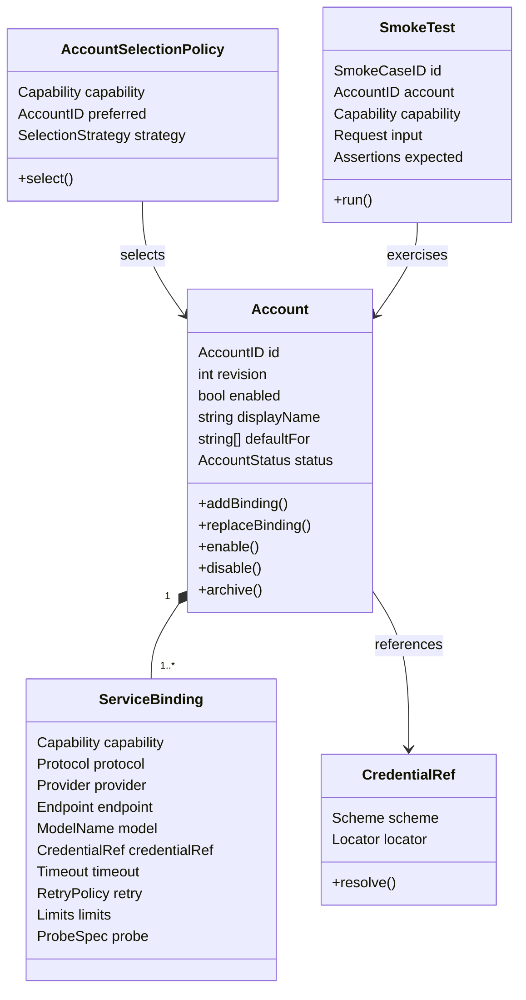

# LLM 账户管理领域模型

## 1. 目标与边界

账户管理是独立于 Session 的全局配置上下文。它负责：

- 管理多个账户及启停、修订和默认路由。
- 为同一账户或不同 provider 配置 `chat`、`tool_call`、`embedding`、`rerank`、`search` 能力。
- 通过 `CredentialRef` 引用密钥，配置文件和会话事件中不出现明文 secret。
- 为每个能力提供独立 endpoint、模型、超时、配额和冒烟探测配置。
- 为 V 模型开发提供可自动验证的真实 API smoke 用例。

账户配置不是会话事实，也不写入 `messages.jsonl`。会话事件只记录本次调用使用的 `account_id`、能力、模型和安全的 endpoint 标识，从而使历史重放不受后续账户修改影响。

账户的领域实体和 JSONL Repository 属于 Hub；跨 Hub/Sessiond 的 DTO、方法和读写接口放在公共包 `pkg/contracts/account/v1`。Hub 获得 `Admin`（读+写），Sessiond 只获得 `Reader`（读）。完整角色用例和权限测试见 [Account 公共契约与模块角色用例](11-account-contract-and-role-usecases.md)。

## 2. 领域模型



### 2.1 Account 聚合

根对象为 `Account`，聚合内包含一个或多个 `ServiceBinding`。

不变量：

- `account_id` 稳定且唯一，不等同于可变的 display name。
- 每个 `account_id` 的 `revision` 单调递增。
- 更新必须带 `expected_revision`；不匹配返回 `conflict`，避免并发覆盖。
- 每个 capability 在同一账户内最多一个 active binding。
- `default_for` 中的 capability 必须有对应 binding，且账户 `enabled=true`。
- 归档账户不能接收新调用，但历史事件仍保留其 account_id/revision。
- 修改凭据引用、endpoint 或模型必须产生新的 revision。

### 2.2 ServiceBinding

能力与协议分离：

| Capability | 用途 | 必需字段 | 典型调用 |
|---|---|---|---|
| `chat` | 普通 LLM 推理 | endpoint、model、credential_ref | `POST /chat/completions` |
| `tool_call` | 模型原生工具调用 | endpoint、model、credential_ref、provider capability | 带 tools 的 chat/completions |
| `embedding` | memory chunk/query 向量 | endpoint、model、dimensions、batch_size | `POST /embeddings` |
| `rerank` | 对混合检索候选重排 | endpoint、model、top_n、max_candidates | 专用 rerank JSON |
| `search` | DeepSeek/其他搜索 API | endpoint、query schema、credential_ref | 专用 search JSON |

`Protocol` 决定 adapter，`Provider` 只用于展示、诊断和能力策略。不要把 provider 名称写进业务分支。

### 2.3 账户状态

```text
Draft -> Validated -> Enabled -> Disabled -> Archived
   |          |           |
   +----------+-----------+-> Invalid
```

- `Draft`：JSONL 可填写，尚未完成校验。
- `Validated`：结构、引用和能力组合校验通过，尚未成为默认路由。
- `Enabled`：可被路由选中。
- `Disabled`：保留配置但不接收新请求。
- `Archived`：只读，不允许恢复为执行账户，需复制为新 ID。
- `Invalid`：校验失败；不得进入运行路由。

“已验证结构”和“真实 API 健康”是两个状态，不能混用。`validated` 不代表 key 可用。

## 3. 路由策略

路由输入：

```text
capability + requested_model(optional) + session/provider preference + availability
```

选择顺序：

1. 明确指定 `account_id` 且 capability 可用。
2. `default_for` 包含该 capability 的启用账户。
3. 按 `priority` 降序，过滤冷却中/配额耗尽/禁用账户。
4. 均不可用则返回 `no_available_account`，不静默换成缺少能力或不同维度的模型。

默认不做跨 provider 自动 fallback；如开启 fallback，必须声明候选和兼容约束。embedding/rerank fallback 还必须检查模型版本和向量维度。

### 3.1 协议适配器归一化

| Protocol | 归一化请求 | 成功响应 |
|---|---|---|
| `openai_compatible` | messages、tools、temperature 等 chat 字段 | content/tool_calls/usage/finish_reason |
| `openai_embeddings_v1` | model + input[] | vectors、model、usage |
| `json_search_v1` | query/filter/limit | results[] 或明确空结果 |
| `json_rerank_v1` | model/query/documents[]/top_n | results[]{index,relevance_score} |

provider 返回结构必须先转换为这些内部对象，再进入 Tool Runtime 或 KnowledgeService。不能把 provider SDK 类型传给领域层。

## 4. 凭据

当前 v1 运行时实际支持：

```text
env:DEEPSEEK_API_KEY
```

`wincred`、`keychain`、`secret-service` 保留为后续 CredentialStore 扩展；
在 adapter 实现前 validate 会拒绝这些 scheme，避免“配置有效但运行时无法解析”。

规则：

- 示例 JSONL 只写引用，不写真实 key。
- `CredentialStore.Resolve` 在请求前解析，解析结果不缓存到事件、日志或 snapshot。
- 错误信息只允许显示 scheme 和 locator 的安全部分，不显示 secret。
- 冒烟测试报告记录“凭据存在/缺失”，不记录值或 hash。

## 5. JSONL 账户文件

### 5.1 文件语义

- 文件：`accounts.jsonl`。
- 每一行是一个完整账户聚合快照。
- 文件加载时按 `account_id` 去重；重复 ID 视为配置错误。
- 更新账户时由 AccountRepository 在锁内写临时文件并原子替换；不是会话事件流。
- `accounts-audit.jsonl` 可追加记录 `created/updated/enabled/disabled/archived/smoke_tested` 等账户审计事件，但它是账户管理审计源，不是 Session 真相源。
- 真实 `accounts.jsonl` 应放在用户数据目录；仓库只提交 `config/llm-accounts.example.jsonl`。

### 5.2 最小记录

```json
{
  "schema_version": 1,
  "account_id": "deepseek-main",
  "revision": 1,
  "enabled": true,
  "display_name": "DeepSeek Main",
  "priority": 100,
  "default_for": ["chat", "tool_call"],
  "services": {
    "chat": {
      "api_key_env": "DEEPSEEK_API_KEY",
      "thinking": {"type": "enabled"},
      "reasoning_effort": "high"
    }
  }
}
```

完整样例见 [config/llm-accounts.example.jsonl](../../config/llm-accounts.example.jsonl)。

DeepSeek chat/tool_call 的未填字段自动补为：

| 字段 | 默认值 |
|---|---|
| provider | `deepseek` |
| protocol | `openai_compatible` |
| base_url | `https://api.deepseek.com` |
| path | `/chat/completions` |
| model | `deepseek-flash` |
| credential_ref | `env:DEEPSEEK_API_KEY` |
| timeout | 120 秒 |
| thinking.type | `enabled` |
| reasoning_effort | `high` |

DeepSeek chat/tool_call 显式使用其他模型（例如 `deepseek-chat`）会 validate
失败，确保账户装配只走 `deepseek-flash`。`api_key_env` 会规范化为
`credential_ref: env:<NAME>`，不会把 key 存入 JSONL。

当前加载器同时接受 `timeout: "120s"` 与 `timeout_ms: 120000`；同一 binding
同时给出时以 `timeout_ms` 为准。JSONL 使用严格字段校验，示例中允许的
`retry`、`limits`、`probe` 与顶层 `metadata` 作为 v1 扩展字段保留，未知字段
会报告行号并拒绝加载。

### 5.3 校验规则

加载或导入账户时校验：

1. `schema_version` 已知。
2. `account_id` 符合安全字符集。
3. `revision >= 1`，更新时校验 expected revision。
4. `base_url` 只接受配置允许的 scheme；本机开发允许 `http://127.0.0.1`。
5. `path` 必须是相对 API path，不在其中写 query secret。
6. `credential_ref` 语法合法。
7. DeepSeek chat/tool_call 的模型只能是 `deepseek-flash`。
8. `thinking.type` 只能是 `enabled`/`disabled`，`reasoning_effort` 只能是
   `none`/`low`/`high`/`max`；兼容别名会规范化为
   `minimal -> low`、`medium/xhigh -> high`。
9. embedding 的 `dimensions > 0`、`batch_size > 0`。
10. rerank 的 `top_n <= max_candidates`。
11. `default_for` 与 services 键一致。
12. 选项未知时不静默忽略；返回 `unknown_field` 或明确的兼容策略。

完整 provider 入参、embedding/rerank 请求响应形状和 Claude Code JSON 配置
对照见 [14-account-provider-configuration.md](14-account-provider-configuration.md)。

## 6. 冒烟测试用例

真实 API 冒烟不由普通 CI 默认执行。建议用例文件：[config/llm-smoke.example.jsonl](../../config/llm-smoke.example.jsonl)。

一条用例包含：

- `case_id`
- `account_id`
- `capability`
- `input`
- `assertions`
- `timeout`
- `tags`
- `enabled`

执行流程：

```text
load accounts
  -> validate account
  -> resolve credential
  -> build capability adapter
  -> call endpoint with minimal request
  -> validate normalized response shape
  -> classify auth/quota/rate-limit/timeout/schema errors
  -> write redacted smoke report
```

命令草案：

```text
hub.exe llm account validate --file config/llm-accounts.example.jsonl
hub.exe llm account smoke --file config/llm-smoke.example.jsonl --tag real-api
hub.exe llm account smoke --account deepseek-main --capability embedding
```

建议退出码：

| 退出码 | 含义 |
|---:|---|
| 0 | 全部通过 |
| 2 | 输入/配置错误 |
| 3 | 凭据缺失 |
| 4 | 鉴权失败 |
| 5 | 额度/限流 |
| 6 | 网络或超时 |
| 7 | 响应 schema/embedding 维度错误 |
| 8 | 内部错误 |

当前 CLI 已实现文件驱动 smoke：

```powershell
hub.exe llm account smoke --file config/llm-smoke.example.jsonl --tag real-api
hub.exe llm account smoke --file config/llm-smoke.local.jsonl --tag real-api
hub.exe llm account smoke --file config/llm-smoke.example.jsonl --offline
```

`--offline` 只校验 case schema、账户、capability 与 timeout；不带该选项时调用
Hub smoke adapter。真实 API 用例必须显式选择并准备环境变量，默认 CI 不执行。

## 7. 真实 API 冒烟矩阵

| 能力 | 最小输入 | 成功断言 | 异常场景 |
|---|---|---|---|
| chat | `"只回复 OK"` | 有非空文本/结束原因 | 401、429、quota、timeout |
| tool_call | 一个只读工具 schema | 返回合法 tool call 或明确 no-tool | capability unsupported、schema invalid |
| embedding | 两个短文本 | 每项维度等于配置且向量有限 | quota、维度不匹配、batch 超限 |
| rerank | 一个 query + 两个候选 | 返回候选 index/score，可稳定排序 | quota、空候选、top_n 越界 |
| search | 一个受控查询 | 有结果或明确的空结果 | auth、quota、rate limit、timeout |

断言“真实可用”只能来自显式执行的 smoke，不能靠字段填写或账户状态推断。

## 8. V 模型测试映射

| 需求 | 单元测试 | 集成/契约测试 | 真实 smoke | 里程碑 |
|---|---|---|---|---|
| 账户结构与 revision | `TestAccountValidation`、`TestRevisionConflict` | 加载 JSONL、默认路由 | `account validate` | M5 |
| 凭据引用 | `TestCredentialRefParse` | env/credential fake | 缺失 key 返回退出码 3 | M5 |
| chat/tool_call | `TestCapabilitySelection` | fake chat server | chat smoke | M5/M6 |
| embedding | `TestEmbeddingDimensionCheck` | fake embeddings server | embedding smoke | M5 |
| rerank | `TestRerankTopN` | fake rerank server | rerank smoke | M5 |
| 搜索 | `TestSearchErrorMapping` | fake search server | search smoke | M4 |
| 密钥脱敏 | `TestNoSecretRendered` | 日志/事件扫描 | smoke 报告扫描 | M5/M10 |

## 9. 失败与恢复

- 账户文件写入中断：保留原文件，临时文件不参与加载。
- JSONL 某行非法：报告行号；默认拒绝加载整个文件，防止半配置运行。
- 凭据缺失：账户可保持 `validated`，但路由跳过并报告 `missing_credential`。
- 额度不足：记录 `quota_exhausted`、scope、reset_at（若 provider 提供）和 retryable=false；不要自动改用未授权账户。
- API schema 变化：适配器返回 `upstream_schema_error`，冒烟失败，保留 provider_request_id 便于定位。
- embedding 维度变化：禁止与旧向量混检，标记索引需要重建。

## 10. 设计决策

| 决策 | 选择 | 原因 |
|---|---|---|
| 账户持久化 | JSONL 快照文件 + 可选 audit JSONL | 标准库可直接解析，方便人工填写和 smoke |
| 能力建模 | Binding 按 capability 拆分 | chat/search/embedding/rerank 的 endpoint 与参数差异大 |
| 密钥 | CredentialRef | 配置可共享，secret 不进入仓库/事件 |
| 路由 | capability-first，默认不跨 provider 静默 fallback | 避免向量维度/工具能力不兼容 |
| 更新 | expected_revision + 原子替换 | 防止并发账户覆盖 |
