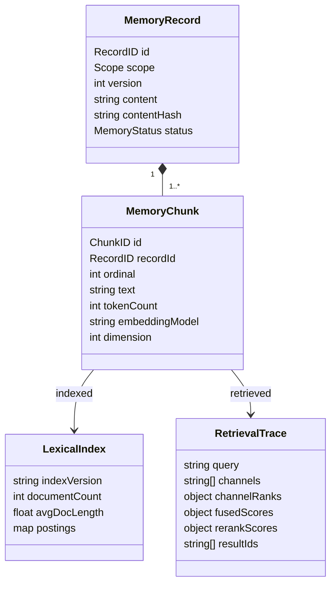
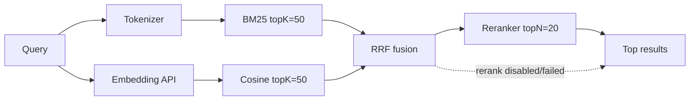

# 工具请求、异常、耗时与混合记忆检索

## 1. 目标

本设计补齐四类能力：

1. 模型原生工具调用和 `/<toolname> <req>` 直调共用同一工具注册、校验、执行、事件与统计链路。
2. 工具异常以稳定结构返回，明确区分额度不足、限流、鉴权、超时和业务失败。
3. 每次工具调用记录排队、校验、执行和总耗时。
4. memory 召回采用知识库混合检索：自研 BM25 + embedding dense retrieval + RRF 融合 + 可选 reranker。

## 2. 两种工具请求模式

### 2.1 模型工具调用

普通聊天请求可以携带 Registry 导出的工具目录。LLM 返回归一化 `ToolCall` 后，Sessiond 走统一 Tool Runtime。

```text
user message
  -> llm.requested(tools=[calculator, search, ...])
  -> llm.completed(tool_calls=[...])
  -> tool.requested(invocation_mode=model)
  -> tool.completed/tool.failed
  -> llm.requested(tool results)
  -> ...
```

工具目录只包含：

- 名称、版本、描述；
- JSON Schema；
- 是否只读、是否有副作用；
- 模型可见的约束。

不得把内部 endpoint、凭据引用、提示词或统计信息暴露给模型。

### 2.2 Slash 直调

TUI/CLI 输入：

```text
/<toolname> <req>
```

示例：

```text
/calculator (12 + 4) * 3
/search Go context cancellation
/read_docs docs/agent-runtime/02-architecture.md
/weatherapi Shanghai 2026-11-04
/memory_search 工具调用 seq 怎么保证顺序
/memory_write scope=workspace text="BM25 参数默认 k1=1.2, b=0.75"
```

解析规则：

1. 首个空白前必须是 `/` 加合法工具名。
2. 首个空白后的全部文本作为原始 `<req>`，不会被 shell 自动拆分。
3. Tool Runtime 先尝试把 `<req>` 解析为 JSON object；失败后调用该工具注册的 `DirectRequestAdapter`，将文本映射为 schema。
4. 工具可声明 `direct_request_field`，例如 calculator 的 `expression`、search 的 `query`、memory_search 的 `query`。
5. 解析失败返回 `invalid_request`，不触发模型。
6. 不存在的工具返回 `unknown_tool`，不把整段输入误当聊天消息。
7. 以 `//` 开头的输入表示转义后的普通文字 `/...`。

服务端是唯一语法权威。TUI 可以本地预览和补全，但 Hub/Sessiond 必须重新校验。

### 2.3 直调也是 Turn

直调不经过 LLM，但仍是一次可追踪操作：

```text
user.tool_command.accepted(tool_name, raw_request)
  -> turn.started(kind=direct_tool, trace_id=...)
  -> tool.requested(invocation_mode=direct)
  -> tool.completed/tool.failed
  -> turn.completed
```

所有事件仍需 Session Actor 提交并取得 seq。直调结果直接返回给 TUI/CLI；不会隐式把结果发送给 LLM，除非用户随后显式发起聊天。

### 2.4 会话 Todo Board

每个 Sessiond 在 `<session-dir>/todo-board.jsonl` 持有一个独立 board。模型和
slash 都通过 `todo_board` 工具访问：

```text
list   -> items + summary
get    -> one item by id
create -> title + idempotency_key
update -> id + expected_version + idempotency_key + changed fields
delete -> id + expected_version + idempotency_key
```

状态为 `pending`、`in_progress`、`blocked`、`completed`；优先级为 `low`、
`medium`、`high`、`urgent`。完成项可以在后续操作中重新打开为 pending/in_progress。
delete 写入 tombstone，避免旧幂等键被误用，但 board list/summary 不显示。

每轮 ReAct system prompt 包含从 tool schema 生成的摘要，提醒模型先读后写、
使用 version 和幂等键；摘要不替代 provider tools schema，也不替代
Tool Runtime/工具实现的服务端校验。TUI `/board` 默认执行 list，也接受 JSON
operation 直调。

## 3. 工具异常契约

### 3.1 统一错误

```json
{
  "code": "quota_exhausted",
  "message": "Embedding provider quota is exhausted",
  "retryable": false,
  "scope": "account",
  "provider": "embedding-provider",
  "request_id": "provider-safe-request-id",
  "reset_at": "2026-12-01T00:00:00Z",
  "details": {
    "account_id": "embedding-main",
    "capability": "embedding",
    "limit": 1000000,
    "remaining": 0
  }
}
```

稳定错误码：

| Code | 含义 | 默认 retryable |
|---|---|---|
| `unknown_tool` | 工具未注册 | false |
| `invalid_request` | 语法/schema 不合法 | false |
| `permission_denied` | 工具或路径无权限 | false |
| `not_found` | 文档/记录不存在 | false |
| `conflict` | 幂等键或版本冲突 | false |
| `missing_credential` | 账户凭据引用无法解析 | false |
| `authentication_failed` | Provider 鉴权失败 | false |
| `quota_exhausted` | 账户/API 额度耗尽 | false |
| `rate_limited` | 频率限制 | true |
| `timeout` | 调用超时 | true |
| `canceled` | 用户/运行时取消 | false |
| `dependency_unavailable` | Hub/知识库/依赖不可用 | true |
| `unsupported_capability` | 模型或账户不支持该能力 | false |
| `embedding_dimension_mismatch` | 向量维度与索引不一致 | false |
| `index_rebuilding` | 向量索引重建中 | true |
| `upstream_schema_error` | Provider 响应不符合协议 | false |
| `partial_result` | 混合检索降级返回部分结果 | false |
| `internal_error` | 未分类内部错误 | false |

`message` 是可展示文本；业务判断、统计和重试必须依赖 `code`。原始 provider body 只可作为脱敏诊断字段。

### 3.2 模型看到的异常

不把 Go error、HTTP 堆栈或完整响应体直接塞进 prompt。Tool Runtime 向模型提供同一结构的 JSON；模型可决定换查询、减少 limit、停止或向用户解释额度不足。

### 3.3 TUI 展示

直调失败时 TUI 显示 code、简短 message、是否可重试、剩余额度和 reset 时间（若存在）。trace 查询可看到脱敏 provider request id。

## 4. 工具耗时

工具请求事件记录 wall-clock 开始时间；完成/失败事件记录：

```json
{
  "timing": {
    "queue_ms": 2,
    "validation_ms": 1,
    "execute_ms": 184,
    "total_ms": 188
  }
}
```

规则：

- `total_ms` 使用 Go monotonic clock 计算，不用两个 wall-clock 时间相减。
- `queue_ms`：命令被 Actor 接受到开始校验。
- `validation_ms`：参数、权限、账户能力解析。
- `execute_ms`：handler + 外部 API + 本地检索的实际执行。
- `total_ms`：从命令进入到结果事件准备完成。
- 失败、取消、超时也必须记录到失败事件。
- 进程崩溃导致的 orphaned call 不伪造耗时；trace 标记 `orphaned=true`，统计单列。
- 工具统计输出调用数、成功/失败数、失败原因、平均耗时及 P50/P95；真实样本从事件重建。

## 5. 知识库归属

### 5.1 方案选择

| 方案 | 核心思路 | 优点 | 缺点 |
|---|---|---|---|
| A：Hub 托管 KnowledgeService（推荐） | Hub 独占写入共享 memory 知识库和索引；Sessiond 工具通过 Hub 本地 IPC 调用 | 多会话共享、单一索引写者、无需新增常驻 exe | hub 不可用时 memory 工具暂时不可用 |
| B：每 Sessiond 各自建索引 | 每个 sessiond 维护自己的 memory 索引 | 进程完全独立 | 跨会话 recall 困难、重复 embedding、索引冲突 |
| C：新增 memoryd.exe | 独立知识库进程 | 故障隔离最好 | 新增进程、IPC、启动项和运维复杂度 |

选择 **A**。Hub 仍不写 Session 真相源；知识库是跨会话共享基础设施，其事务和审计独立管理。

### 5.2 Hub KnowledgeService

负责：

- memory record/chunk 的持久化；
- BM25 倒排索引；
- dense 向量和索引版本；
- embedding、rerank 账户选择与 API 调用；
- 混合召回和重排；
- 索引重建与一致性水位。

不负责：

- 创建 `tool.requested/completed` Session 事件；这些事件由 Sessiond Tool Runtime 记录；
- 决定 ReAct 下一步；
- 向事件账本写 memory 结果。

Sessiond 的 memory handler 调用 Hub 本地 Knowledge API，然后把结果返回到 Tool Runtime。Hub 不可用时返回 `dependency_unavailable`。

## 6. Memory 领域



记录状态：

```text
Staged -> Indexing -> Ready
                   -> Failed
Ready  -> Updating -> Ready
                    -> Failed
Ready  -> Deleted
```

默认 memory 作用域为 `workspace`；支持 `workspace`、`user`、`global`，实际允许范围由权限配置决定。

### 6.1 写入和更新一致性

`memory_write` / `memory_update`：

1. 校验 scope、幂等键和内容大小。
2. 切分 chunk。
3. 构建新版本的 BM25 倒排项。
4. 批量调用 embedding API。
5. 校验返回数量、维度、有限值。
6. 原子发布新 record 版本和索引 snapshot。
7. 旧版本 chunk 从检索索引移除，保留审计引用。

默认写入是同步完成索引后才返回 `Ready`。embedding 额度不足时不发布半成品；返回 `quota_exhausted`。也可配置后台索引模式，但此时工具结果必须返回 `Staged/Indexing`，不能声称可召回。

### 6.2 存储布局

```text
memory/
  records.jsonl              # memory 自身真相源
  chunks.jsonl               # 从 record 构建，可重建
  lexical/
    index.json               # BM25 快照，可重建
    manifest.json            # version/watermark/config
  vectors/
    <model-fingerprint>.jsonl
    manifest.json
  audit.jsonl                # 写入/更新/删除/重建审计
```

向量 key 必须包含 `embedding_model + dimensions + normalization + index_version`，不得用不同模型产生的向量直接比较。

## 7. BM25 实现

### 7.1 算法

对查询词项 `q_i` 和 chunk `D`：

```text
IDF(q_i) = ln(1 + (N - df(q_i) + 0.5) / (df(q_i) + 0.5))

score(D, Q) =
  sum over q_i in Q:
    IDF(q_i) *
    (tf(q_i, D) * (k1 + 1)) /
    (tf(q_i, D) + k1 * (1 - b + b * |D| / avgdl))
```

默认：

- `k1 = 1.2`
- `b = 0.75`
- `N`：可检索 chunk 数
- `df(q_i)`：包含该 token 的 chunk 数
- `tf(q_i, D)`：token 在 chunk 中的词频
- `|D|`：chunk token 数
- `avgdl`：所有可检索 chunk 的平均 token 数

相同分数按 `record_id`、`chunk_id` 稳定排序。

### 7.2 Tokenizer

自研默认 tokenizer：

1. Unicode `ToLower` 规范化。
2. 连续 Latin 字母/数字组成一个 term。
3. CJK 连续片段生成单字与相邻 bigram，兼容中文无空格文本。
4. 标点和空白作为分隔符；可选常见停用词过滤。
5. 所有 token 带长度限制，避免异常输入撑爆索引。

`Tokenizer` 是注入接口，后续可替换为词典分词器，但 BM25 scorer 和索引结构保持不变。

### 7.3 倒排索引

```go
type LexicalIndex interface {
    Upsert(ctx context.Context, chunks []IndexedChunk) error
    Delete(ctx context.Context, chunkIDs []string) error
    Search(ctx context.Context, query string, limit int) ([]LexicalHit, error)
    Snapshot(ctx context.Context) (IndexManifest, error)
}
```

索引结构至少保存：

- `token -> postings[] {chunk_id, tf}`
- `chunk_id -> doc_length`
- `document_count`
- `avg_doc_length`
- `index_version`

更新使用 copy-on-write 或暂存文件 + 原子替换，读查询只能看到完整版本，不能看到半更新的 postings。

## 8. Embedding 与 Reranker

### 8.1 Embedding

```go
type EmbeddingClient interface {
    Embed(ctx context.Context, texts []string) (EmbeddingBatch, error)
}

type EmbeddingBatch struct {
    Vectors    [][]float32
    Model      string
    Dimensions int
    Usage      Usage
}
```

约束：

- 使用账户 `embedding` binding。
- 批量大小、超时和最大输入长度来自 binding。
- 返回向量数必须等于输入数。
- 每个向量维度必须等于 binding.dimensions。
- 所有分量必须 finite；必要时归一化。
- 使用 cosine similarity；零向量返回 `upstream_schema_error`。
- 查询和文档必须使用同一 embedding model fingerprint。

### 8.2 Reranker

```go
type RerankClient interface {
    Rerank(ctx context.Context, req RerankRequest) (RerankResponse, error)
}
```

输入只包含 query 和候选文本，不包含内部 secret、完整事件账本或无关 metadata。输出 index/score 必须校验范围、去重和有限值；服务端漏回的候选按失败策略处理，不能默认补最高分。

### 8.3 账户能力

`chat`、`tool_call`、`embedding`、`rerank` 和 `search` 通过 ServiceBinding 独立选账户。账户配置详见 [账户管理领域模型](09-account-management.md)。

会话事件记录：

- `account_id`
- `capability`
- `model`
- 安全的 endpoint alias
- usage 或 token/request 统计（若 provider 提供）

不记录密钥、authorization header 和完整 embedding 向量。

## 9. 混合召回流程



默认参数：

| 参数 | 默认值 |
|---|---:|
| BM25 candidates | 50 |
| dense candidates | 50 |
| RRF `k` | 60 |
| BM25 channel weight | 1.0 |
| dense channel weight | 1.0 |
| rerank candidates | 20 |
| final results | 5–10（请求 limit 决定） |

RRF：

```text
rrf(chunk) = sum_c(weight_c / (k + rank_c(chunk)))
```

只有出现在某通道候选集中的 chunk 才得到该通道分数。融合后按 RRF 分数、chunk_id 稳定排序，取前 `rerank_candidates` 交给 reranker。

### 9.1 降级策略

默认 `allow_degraded=false`，避免静默改变召回质量：

| 故障 | strict | allow_degraded=true |
|---|---|---|
| embedding quota/auth/timeout | 返回对应错误 | BM25-only，返回 `partial_result` warning |
| reranker quota/timeout/schema | 返回对应错误 | 返回 RRF 排序，附 warning |
| BM25 索引损坏 | 重建；重建期间 `index_rebuilding` | 不使用可能不一致的索引 |
| 向量索引重建中 | 可配置等待或 `index_rebuilding` | BM25-only |

工具结果：

```json
{
  "ok": true,
  "degraded": true,
  "warnings": [
    {
      "code": "partial_result",
      "message": "Embedding unavailable; lexical channel only",
      "cause": "quota_exhausted"
    }
  ],
  "results": [
    {
      "record_id": "mem_01...",
      "chunk_id": "mem_01..._2",
      "text": "...",
      "source": "workspace",
      "lexical_rank": 1,
      "dense_rank": null,
      "fusion_score": 0.0322,
      "rerank_score": null
    }
  ],
  "retrieval": {
    "channels": ["bm25"],
    "index_version": "7",
    "query_embedding_model": null,
    "rerank_model": null,
    "duration_ms": 18
  }
}
```

### 9.2 召回可观测性

`memory_search` 的 `tool.completed` payload 或 `tool.failed` diagnostics 记录：

- 请求参数摘要；
- `channels_used`
- BM25 `index_version`
- embedding model fingerprint（不记录向量）
- reranker model
- candidate counts、返回数
- `fusion_ms`、`embedding_ms`、`rerank_ms`、`total_ms`
- top-K doc IDs 或安全摘要
- degraded/warnings

这些字段用于 trace 和离线评估，但不得把完整记忆内容复制到无关会话事件中。

## 10. `/toolname req` 安全规则

- 工具必须先注册，slash 输入不能绕过 Registry。
- 权限在服务端工具运行时检查，TUI 自检不算授权。
- read_docs 仍受允许根目录约束。
- memory 写入/更新仍需要幂等键；CLI 可自动生成，但重试必须复用。
- 网络工具受 timeout、取消和大小上限约束。
- 参数和结果进入事件前做大小限制与脱敏。
- 工具结果可能包含用户文档内容，TUI 显示时需转义控制字符，不执行终端 escape。

## 11. V 模型测试

### BM25 单元测试

- 与手工计算的小型语料逐项对比 score；
- `k1`、`b` 边界；
- 空查询、OOV、单文档；
- 中文单字/bigram 召回；
- 更新/删除后 IDF、avgdl、postings 正确；
- 分数相同稳定排序；
- 快照原子切换，无半更新可见。

### 混合检索集成测试

- BM25 与 dense 不同排序被 RRF 正确融合；
- reranker 输入候选数、最终 topK 正确；
- embedding 维度不匹配返回稳定错误且不污染索引；
- embedding quota → `quota_exhausted`；
- rerank quota → strict 失败或 degraded RRF；
- 账户切换后不混用不兼容向量；
- 删除索引可从 memory records 重建。

### 工具请求测试

- `/calculator 1+2*3` 产生 direct_tool turn 和 tool events；
- 未知 slash command 返回 `unknown_tool`；
- LLM tool_call 与直调使用同一 Registry 和 Tool Runtime；
- 参数校验失败、额度不足、超时都被结构化；
- 崩溃后 orphaned call 不伪造成功或耗时；
- 统计按 direct/model 两种 invocation mode 汇总。

## 12. 实现步骤

| # | 步骤 | 主要模块 | 验证 |
|---:|---|---|---|
| 1 | Account domain + JSONL loader | `llm/domain`、`llm/app` | schema/revision/credential tests |
| 2 | Chat/embedding/rerank/search adapters | `llm/adapters` | fake server contract tests |
| 3 | Tool direct parser + unified error/timing | `tooling`、`operator` | direct slash tests、quota tests |
| 4 | Knowledge record/chunk store | `knowledge/domain/app` | replay/version/idempotency |
| 5 | BM25 tokenizer/scorer/index | `knowledge/bm25` | formula/property tests |
| 6 | Embedding index + model fingerprint | `knowledge/vector` | dimension/normalization tests |
| 7 | Hybrid retriever + RRF + rerank | `knowledge/retrieval` | channel fusion tests |
| 8 | Memory tools through Hub Knowledge API | `tools/memory`、Hub | process integration tests |
| 9 | Retrieval telemetry/trace/stats | `observability` | rebuild and duration tests |
| 10 | Real API smoke harness | `cmd/hub`、V-model suite | opt-in reports |

## 13. 风险与缓解

| 风险 | 缓解 |
|---|---|
| BM25 中文分词质量 | CJK unigram+bigram 基线；Tokenizer 接口保留替换 |
| embedding 模型/维度漂移 | model fingerprint + index version；不兼容则重建 |
| reranker 延迟或额度耗尽 | 容量限制、strict/degraded 明确策略、稳定错误 |
| Hub KnowledgeService 成为依赖 | 仅 memory 工具受影响；返回 `dependency_unavailable`，不影响其他工具/sessiond |
| 索引更新半完成 | copy-on-write snapshot + atomic rename |
| 排名不可复现 | 固定参数、稳定 tie-break、记录 index/model 版本 |
| 真实 API 冒烟泄漏 secret | CredentialRef + 报告脱敏 + opt-in |
