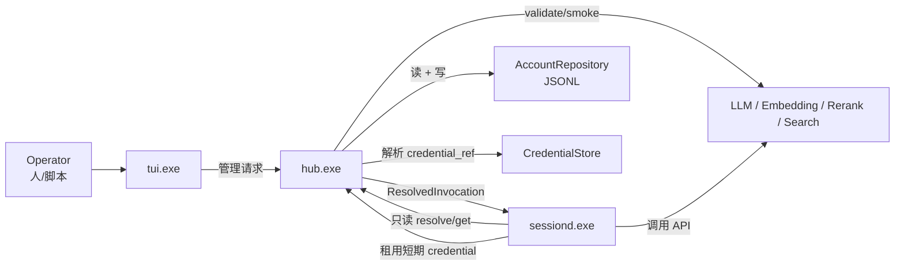
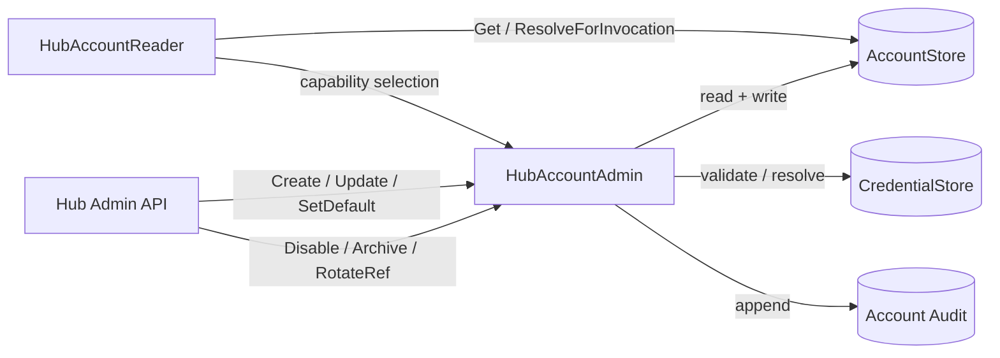
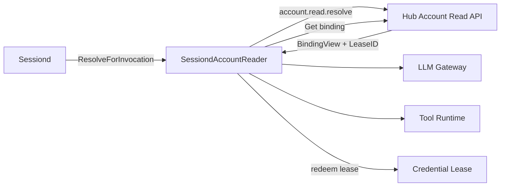
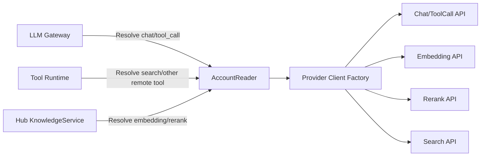
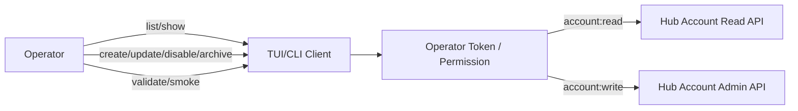

# Account 公共契约与模块角色用例

## 1. 设计目标

账户会同时被 Hub 和 Sessiond 使用，因此需要：

1. 一个稳定的公共 Go 包承载跨进程契约。
2. 明确 Hub 具备账户读/写权限，Sessiond 只有读权限。
3. 通过接口、IPC method allowlist 和 token scope 三重约束权限，不能只依赖调用方自觉。
4. 公共契约不暴露账户领域实体、JSONL 文件结构或真实 secret。
5. 每个模块只获得完成自身工作所需的最小读模型。

## 2. 公共包位置

```text
pkg/
  contracts/
    account/
      v1/
        types.go       # Capability、AccountRef、BindingView、ReadView
        read.go        # Reader interface + read request/response
        admin.go       # Admin interface + write commands
        methods.go     # IPC/HTTP method constants
        errors.go      # stable contract error codes
    credential/
      v1/              # opaque lease + credential broker contract
    session/
      v1/              # 后续会话控制契约
    tool/
      v1/              # 后续工具请求/结果契约
    knowledge/
      v1/              # 后续 memory/hybrid retrieval 契约
```

规则：

- `pkg/contracts/**` 是唯一允许同时被 Hub、Sessiond、TUI/CLI 引用的公共边界。
- 公共包只能依赖 Go 标准库；不得 import `internal/*`。
- 领域实体 `Account`、`ServiceBinding`、Repository 实现、JSONL loader 留在 Hub 内部。
- 公共 DTO 使用显式 JSON 字段和版本号，不直接复用数据库/文件模型。
- 破坏性变更新建 `v2`，不得修改已发布 `v1` 的字段语义。
- 业务调用方在自己的模块定义最小 port；跨进程的稳定 schema 与 client/server interface 放公共契约包。

## 3. 权限角色

| 角色 | 所在模块 | Account 权限 | 用途 |
|---|---|---|---|
| `Operator` | TUI/CLI 操作者 | 通过 Hub 请求管理操作 | 查看、创建、修改、启停、归档、smoke |
| `HubAccountAdmin` | Hub | 读 + 写 | 账户管理应用服务和外部管理 API |
| `HubAccountReader` | Hub | 读 | KnowledgeService、路由、内部诊断 |
| `SessiondAccountReader` | Sessiond | 读 | 解析 capability、读取绑定、发起 API |
| `ToolingAccountConsumer` | Sessiond/Tooling | 只读解析 | 网络工具/模型工具选择账户 |
| `ProviderCredentialConsumer` | Sessiond LLM/Knowledge client | 使用短期 lease | 调用 chat/embedding/rerank/search API |

明确禁止：

- Sessiond 不能 list 全部账户；只能按 capability/account_id 解析所需配置。
- Sessiond 不能 create/update/disable/archive/set-default/import/rotate credential。
- Tool 实现不能读取 AccountStore 文件或拿到 `Admin` 接口。
- TUI 不直接读取账户 JSONL；所有操作通过 Hub 管理 API。
- `AccountView` 不包含 secret；调用所需的短期凭据通过单独 `credential/v1` lease 获取。

## 4. Account 公共类型

以下是当前 v1 契约的核心形状：

```go
package accountv1

type Capability string

const (
    CapabilityChat      Capability = "chat"
    CapabilityToolCall  Capability = "tool_call"
    CapabilityEmbedding Capability = "embedding"
    CapabilityRerank    Capability = "rerank"
    CapabilitySearch    Capability = "search"
)

type AccountRef struct {
    AccountID string `json:"account_id"`
    Revision  uint64 `json:"revision"`
}

type BindingView struct {
    Capability   Capability `json:"capability"`
    Provider     string     `json:"provider"`
    Protocol     string     `json:"protocol"`
    BaseURL      string     `json:"base_url"`
    Path         string     `json:"path"`
    Model        string     `json:"model"`
    Thinking     *ThinkingConfig `json:"thinking,omitempty"`
    ReasoningEffort string  `json:"reasoning_effort,omitempty"`
    Dimensions   int        `json:"dimensions,omitempty"`
    BatchSize    int        `json:"batch_size,omitempty"`
    TopN         int        `json:"top_n,omitempty"`
    MaxCandidates int       `json:"max_candidates,omitempty"`
    TimeoutMS    int64      `json:"timeout_ms"`
}

type AccountView struct {
    Ref          AccountRef     `json:"ref"`
    DisplayName  string         `json:"display_name"`
    Enabled      bool           `json:"enabled"`
    Status       string         `json:"status"`
    DefaultFor   []Capability   `json:"default_for,omitempty"`
    Capabilities []Capability   `json:"capabilities"`
    Bindings     []BindingView  `json:"bindings,omitempty"`
}

type ThinkingConfig struct {
    Type string `json:"type"`
}

type ResolveRequest struct {
    Capability       Capability `json:"capability"`
    PreferredID      string     `json:"preferred_account_id,omitempty"`
    RequiredModel    string     `json:"required_model,omitempty"`
    Purpose          string     `json:"purpose"`
}

type ResolvedInvocation struct {
    Account   AccountRef  `json:"account"`
    Binding   BindingView `json:"binding"`
    LeaseID   string      `json:"credential_lease_id"`
    ExpiresAt time.Time   `json:"expires_at"`
}
```

`BindingView` 不包含 `credential_ref`。Sessiond 通过 `credential/v1` 使用 `LeaseID` 获取短期 secret；lease 不进入事件、日志、TUI 或持久化配置。

## 5. 读写接口

```go
type Reader interface {
    Get(ctx context.Context, ref AccountRef) (AccountView, error)
    ResolveForInvocation(ctx context.Context, req ResolveRequest) (ResolvedInvocation, error)
}

type Admin interface {
    Reader
    List(ctx context.Context, filter ListFilter) ([]AccountView, error)
    Create(ctx context.Context, cmd CreateAccount) (AccountView, error)
    Update(ctx context.Context, cmd UpdateAccount) (AccountView, error)
    SetDefault(ctx context.Context, cmd SetDefault) (AccountView, error)
    SetEnabled(ctx context.Context, cmd SetEnabled) (AccountView, error)
    RotateCredentialRef(ctx context.Context, cmd RotateCredentialRef) (AccountView, error)
    Archive(ctx context.Context, ref AccountRef) error
    Validate(ctx context.Context, cmd ValidateAccount) (ValidationReport, error)
    Smoke(ctx context.Context, cmd SmokeRequest) (SmokeReport, error)
}
```

注意：`Admin` 是 Hub 内部/管理面契约；Sessiond 只注入 `Reader`，且运行时的 read-only IPC 不接受 `Admin` 方法。

## 6. 操作矩阵

| 操作 | 类型 | Hub | Sessiond | TUI/CLI |
|---|---|---|---|---|
| `account.read.get` | 读 | 允许 | 允许，限所需 ID | 允许，经 Hub |
| `account.read.resolve` | 读 | 允许 | 允许 | 允许，经 Hub |
| `account.admin.list` | 读（管理视图） | 允许 | 禁止 | 允许，经 Hub |
| `account.admin.create` | 写 | 允许 | 禁止 | 允许，经 Hub |
| `account.admin.update` | 写 | 允许 | 禁止 | 允许，经 Hub |
| `account.admin.set_default` | 写 | 允许 | 禁止 | 允许，经 Hub |
| `account.admin.set_enabled` | 写 | 允许 | 禁止 | 允许，经 Hub |
| `account.admin.rotate_credential_ref` | 写 | 允许 | 禁止 | 允许，经 Hub |
| `account.admin.archive` | 写 | 允许 | 禁止 | 允许，经 Hub |
| `account.admin.validate` | 读/诊断 | 允许 | 禁止 | 允许，经 Hub |
| `account.admin.smoke` | 读/诊断，可能消耗额度 | 允许 | 禁止 | 允许，经 Hub |
| `credential.lease.redeem` | 读/凭据使用 | 允许 | 允许，仅绑定到 invocation | 禁止 |

“允许”仍表示经过认证与授权；不是所有本地进程天然拥有操作者权限。

## 7. 总体用例图



Account 的所有权在 Hub；Sessiond 只读取调用所需的投影，不拥有账户生命周期。

## 8. Hub 角色用例



Hub 用例：

- `ListAccounts`：查看安全账户视图。
- `ManageAccount`：创建、修订、启停、归档。
- `SetDefaultCapability`：设置某个 capability 的默认账户。
- `ValidateAccount`：校验 schema、revision、binding。
- `RunSmoke`：按用例文件调用真实 API，输出脱敏报告。
- `ResolveForInvocation`：解析账户和短期 credential lease。
- `AuditWrite`：任何写操作写入账户审计流。

Hub 不把 `Account` 领域对象直接传给 Sessiond，只返回 `AccountView` / `ResolvedInvocation`。

## 9. Sessiond 角色用例



Sessiond 用例：

- `ResolveChatAccount`：为一次 model request 选择 chat/tool_call binding。
- `ResolveEmbeddingAccount`：仅当 Sessiond 直接发起 embedding 时读取；memory 搜索通常由 Hub KnowledgeService 调用。
- `ResolveSearchAccount`：为 search 工具取 API 配置。
- `ReadBinding`：读取 endpoint/model/timeout，不读账户管理列表。
- `UseCredentialLease`：获取短期 secret，完成一次 provider 调用后丢弃。

Sessiond 的负向用例必须由测试证明：

- 调用 `account.admin.update` 返回 `permission_denied`。
- 调用 `account.admin.list` 返回 `permission_denied`。
- 修改默认账户返回 `permission_denied`。
- 读取账户文件路径返回 `permission_denied`。

## 10. Tooling / LLM / Knowledge 模块用例



模块权限：

- LLM Gateway：读取 chat/tool_call binding + credential lease。
- Tool Runtime：读取所调用网络工具需要的 binding；本地工具不能读取账户。
- KnowledgeService：读取 embedding/rerank binding。
- Provider adapter：只接收已解析的 binding/credential，不访问 AccountStore。

## 11. TUI/CLI 操作者用例



TUI 只显示 `AccountView` 和脱敏诊断结果：

- 可以看到 capability、endpoint alias、模型、状态、revision。
- 不能看到 secret。
- 修改操作必须带 `expected_revision` 和确认提示。
- Sessiond 事件中的 account_id/revision 可以在 trace 中展示。

## 12. 公共 wire contract

建议使用统一 envelope：

```json
{
  "contract": "vibe.account",
  "version": 1,
  "request_id": "req-01J...",
  "method": "account.read.resolve",
  "payload": {}
}
```

Response：

```json
{
  "contract": "vibe.account",
  "version": 1,
  "request_id": "req-01J...",
  "ok": false,
  "error": {
    "code": "permission_denied",
    "message": "sessiond role cannot call account.admin.update"
  }
}
```

服务端在执行 method 前完成：

1. contract/version 校验。
2. request_id 上限和去重。
3. token scope 校验。
4. method allowlist 校验。
5. payload schema 校验。
6. `expected_revision` 校验（写操作）。

## 13. 循环依赖控制

```text
pkg/contracts/account/v1
        ↑                  ↑
Hub admin/read adapter     Sessiond read client
        ↑                  ↑
internal/accounts/app   internal/sessionruntime
        ↓
internal/accounts/domain
        ↓
internal/accounts/adapters
```

禁止：

- `internal/accounts/domain` import `pkg/contracts/account/v1`。
- `pkg/contracts` import `internal/accounts`。
- Sessiond import account JSONL adapter。
- Hub domain 直接返回 wire DTO，不经过 mapper。

## 14. 授权与审计

角色 token：

- `account:read`：Hub 和 Sessiond 可读。
- `account:write`：仅 Hub 管理面/授权 Operator。
- `account:diagnose`：Hub 管理面；可能消耗额度。
- `credential:use`：Sessiond 仅可针对已解析 invocation 兑换 lease。

写操作审计至少包含：

```text
actor_id
operator_session_id
action
account_id
expected_revision
result_revision
changed_fields
request_id
timestamp
```

不得包含 secret、完整 authorization header 或未脱敏 provider body。

## 15. V 模型测试

| 测试 | 层级 | 断言 |
|---|---|---|
| `TestAccountReaderCannotCallAdmin` | 编译/单元 | Sessiond 构建只依赖 Reader，不存在 Admin 引用 |
| `TestSessiondWriteTokenDenied` | 集成 | write method 返回 `permission_denied` |
| `TestHubAdminReadWrite` | 集成 | Hub 管理角色可以 CRUD/路由 |
| `TestResolveMinimizesView` | 单元 | Sessiond 响应不含 secret/凭证引用/不支持字段 |
| `TestResolveRevisionSnapshot` | 集成 | 修改账户后旧 revision 的调用仍可追溯 |
| `TestCredentialLeaseTTL` | 集成 | 过期 lease 返回 `lease_expired` |
| `TestAccountWriteAudit` | 审计 | 每次写操作有前后 revision 和 changed fields |
| `TestPublicContractNoInternalImports` | 静态 | `pkg/contracts` 无 internal 依赖 |
| `TestAccountContractCompatibility` | 契约 | v1 fixture 可被 Hub 和 Sessiond clients 解析 |

### 真实 API 冒烟边界

`account.admin.smoke` 只在 Hub 管理上下文执行；Sessiond 不能触发账户 smoke。真实 smoke 结果写入 Hub 的脱敏报告，不写入任何 Session 的 `messages.jsonl`。
