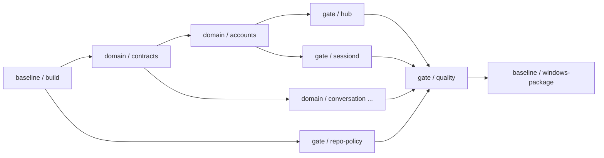

# CI、领域门禁与自动构建基线

## 1. 目标

CI 必须保证：

1. 每次 commit push 或 PR 自动执行全量 build/test 基线。
2. 公共 contract、account 和其他领域分别有独立测试 job。
3. Hub 和 Sessiond 使用独立测试门禁，不能用一个混合 job 掩盖权限边界回归。
4. 公共契约不允许依赖 `internal/*`。
5. Sessiond 不允许依赖 Hub 实现或 Account JSONL adapter。
6. Windows 发布物必须由 CI 成功构建并上传。

工作流文件：[.github/workflows/ci.yml](../../.github/workflows/ci.yml)。

## 2. 触发策略

```yaml
on:
  push:
  pull_request:
  workflow_dispatch:
```

每次 commit 被 push 后都会启动 CI。PR 也会启动同一门禁；手工触发用于诊断。

本地仓库已支持可选 pre-commit 基线：

```text
.githooks/pre-commit
```

启用：

```powershell
git config core.hooksPath .githooks
```

Hook 执行：

```powershell
go build ./...
go test -count=1 ./...
```

本地 hook 用于快速反馈；远端 CI 才是合并门禁。

## 3. CI Job 拓扑



## 4. 基线 job

`baseline / build`：

```text
go build ./...
go test -count=1 ./...
```

该 job 在每次 push/PR 执行，是“commit 自动 build 基线”的入口。

## 5. 按领域拆分

| Job | 路径/命令 | 负责内容 |
|---|---|---|
| `domain / contracts` | `go test ./pkg/contracts/...` | DTO、method、读写接口、错误码兼容性 |
| `domain / accounts` | `go test ./internal/accounts/...` | Account 聚合校验、Repository ports |
| `domain / conversation` | `go test ./internal/conversation/...` | 会话、turn、Actor、队列 |
| `domain / eventledger` | `go test ./internal/eventledger/...` | seq、事件信封、重放 |
| `domain / contextmgr` | `go test ./internal/contextmgr/...` | 上下文预算、压缩 |
| `domain / tooling` | `go test ./internal/tooling/...` | Registry、直调、异常、耗时 |
| `domain / knowledge` | `go test ./internal/knowledge/...` | BM25、向量、hybrid recall |
| `domain / llm` | `go test ./internal/llm/...` | Account-backed provider adapters |
| `domain / sessionruntime` | `go test ./internal/sessionruntime/...` | hub/sessiond 生命周期与 IPC |
| `domain / observability` | `go test ./internal/observability/...` | trace、latency、stats |
| `domain / operator` | `go test ./internal/operator/...` | CLI/TUI use cases |
| `domain / platform` | `go test ./internal/platform/...` | OS adapters |
| `domain / bootstrap` | `go test ./internal/bootstrap/...` | 显式装配 |

当前各领域均已接入实现测试；新增测试应继续进入对应领域 job，而不是只堆到全量 job。

## 5.1 Package README 纪律门禁

Job：`gate / repo-policy`

```text
bash scripts/check-package-readmes.sh
```

该 job 通过 `go list` 枚举所有 Go package，并要求每个 package 目录包含：

- `README.md`
- `## Role`
- `## API / Methods`
- `## Boundaries`
- `## Verification`

新增 package 或修改导出 API 时，必须同步 README。Windows 本地可运行：

```powershell
powershell -File scripts/check-package-readmes.ps1
```

## 6. Hub 门禁

Job：`gate / hub`

```text
go test -count=1 -v ./internal/hub/...
go build -trimpath -o /tmp/hub ./cmd/hub
```

当前断言：

- Hub 可调用全部 account 方法。
- Hub 拒绝未知 account method。
- Hub 构建成功。

后续增加：

- Account admin R/W use cases；
- process manager；
- hub control API；
- session registry/reattach；
- 管理操作审计。

## 7. Sessiond 门禁

Job：`gate / sessiond`

```text
go test -count=1 -v ./internal/sessiond/...
go build -trimpath -o /tmp/sessiond ./cmd/sessiond
```

当前断言：

- Sessiond 只允许 `account.read.get` 和 `account.read.resolve`。
- Sessiond 拒绝所有账户写方法。
- Sessiond 拒绝 admin list/diagnose/smoke。

依赖边界：

```text
sessiond 不得依赖 vibe-agent/internal/hub
sessiond 不得依赖 vibe-agent/internal/accounts/adapters
```

CI 使用 `go list -deps` 强制检查。后续增加：

- 只读 IPC token/scope；
- account reader client；
- Actor 恢复；
- tool/model 调用；
- crash/reattach。

## 8. Public contract 门禁

`domain / contracts` 除运行测试外，还执行：

```text
go list -deps ./pkg/contracts/...
```

若输出包含 `vibe-agent/internal/*`，CI 失败。

后续 contract fixture 必须同时被：

- Hub server adapter；
- Sessiond read client；
- TUI/CLI admin client；

解析。破坏性变更必须新建版本包，不能直接改 v1 语义。

## 9. Quality 门禁

`gate / quality`：

```text
go vet ./...
go test -race -count=3 ./...
```

这项门禁依赖 Hub、Sessiond 和所有领域 job 成功。后续涉及 goroutine、进程、索引并发或 Actor 状态时，不允许跳过 race。

## 10. Windows 发布基线

`baseline / windows-package`：

```powershell
go build -trimpath -o bin/hub.exe ./cmd/hub
go build -trimpath -o bin/sessiond.exe ./cmd/sessiond
go build -trimpath -o bin/startup.exe ./cmd/startup
go build -trimpath -o bin/tui.exe ./cmd/tui
```

构建结果作为 GitHub Actions artifact 上传，名称包含 commit SHA。

构建后先运行短链路冒烟，再运行完整 UAT：

```powershell
powershell -NoProfile -ExecutionPolicy Bypass -File scripts/smoke-chain.ps1 -BinDir bin
powershell -NoProfile -ExecutionPolicy Bypass -File scripts/tui-toolchain-smoke.ps1 -BinDir bin
powershell -NoProfile -ExecutionPolicy Bypass -File scripts/uat.ps1 -BinDir bin
```

`smoke-chain.ps1` 使用临时数据根验证 hub/sessiond 的 snapshot、history、
watch timeout 和 A/B event_id 隔离；`tui-toolchain-smoke.ps1` 通过隐藏 PTY
和 fake Anthropic-compatible provider 验证 `todo_board` 五步 CRUD 与 TUI 渲染。

## 11. 分支保护建议

建议把以下检查设为 required：

- `baseline / build`
- `domain / contracts`
- `domain / accounts`
- `gate / hub`
- `gate / sessiond`
- `gate / repo-policy`
- `gate / quality`
- `baseline / windows-package`

`capability-domains` 矩阵中的失败项也必须全部通过，不能只要求整个 workflow 成功。

## 12. 新增领域/测试的规则

新增领域时：

1. 在 `internal/<domain>` 建包。
2. 若存在跨进程 contract，在 `pkg/contracts/<domain>/v1` 建版本包。
3. 给领域分配独立 CI matrix 项或独立 job。
4. Hub/Sessiond 权限相关测试不得合并在领域测试中。
5. 公共契约增加兼容性 fixture。
6. 涉及并发/索引的测试在 quality job 跑 race。

## 13. 当前基线状态

本地已建立并通过：

- `go build ./...`
- `go test -count=1 ./...`
- `go vet ./...`
- `go test -race -count=3 ./...`
- public contract 无 internal 依赖
- sessiond 无 hub/account adapter 依赖
- Windows 四 exe 构建、两个 smoke 脚本与 `scripts/uat.ps1`
- package README 32 个包
- 文件驱动 offline/fake account smoke

GitHub hosted required checks 在首次 commit 并 push 后运行；本轮没有 remote，
且用户未要求 commit/push，因此未伪造远端 CI 成功。
